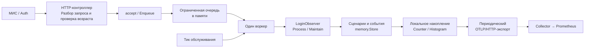
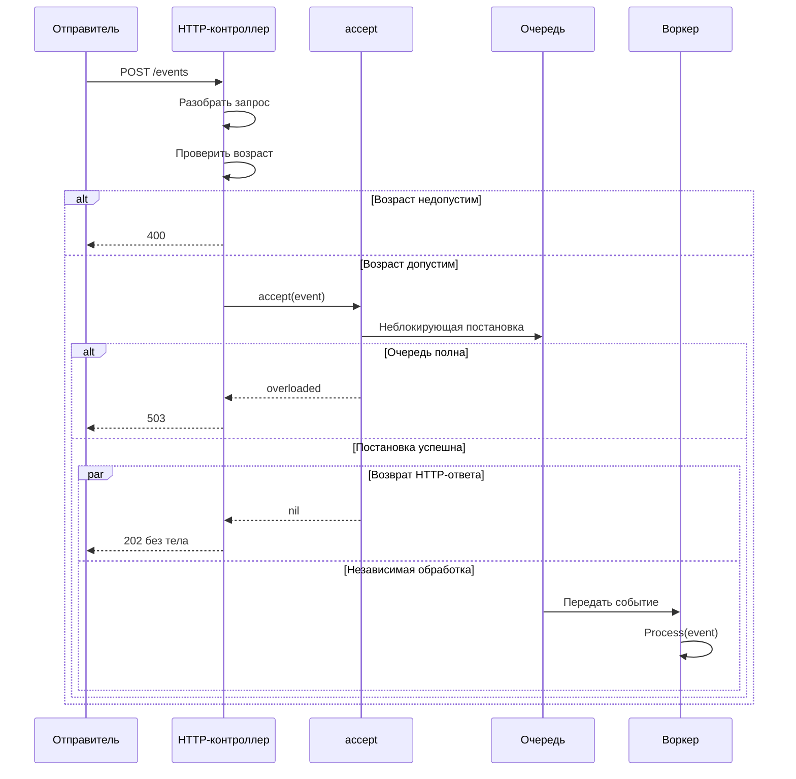
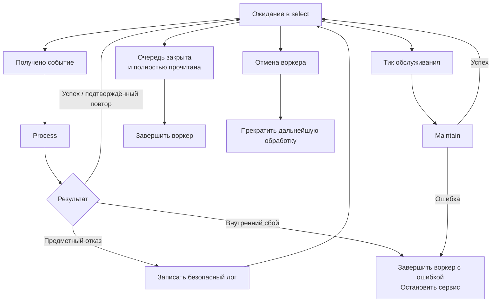
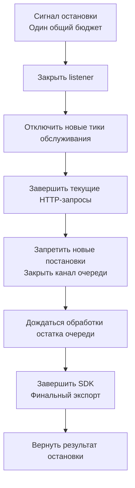

# Асинхронный приём событий

**Приём события и его обработка независимы**. HTTP ждёт только результата постановки в очередь — не изменения сценария и не отправки метрик.

## 1. Общая схема



Здесь три разных результата:

| Результат | Что подтверждает |
|---|---|
| HTTP `202` | Событие поставлено в очередь |
| Завершение `Process` | Применены правила обработки, возможно обновлены измерения |
| Успешный OTLP-экспорт | Получатель принял пакет метрик |

**Один результат не гарантирует следующий.**

## 2. Как принимается HTTP-запрос

Код: [controller.go](../backend/user-login/internal/presentation/http/controller/controller.go),
[event.go](../backend/user-login/internal/presentation/http/controller/event.go),
[event_queue.go](../backend/user-login/internal/infrastructure/queue/event_queue.go). Регистрирует
маршруты [bootstrap](../backend/user-login/bootstrap/route.go).

### HTTP-контроллер

Проверяет транспортное представление:
- метод;
- Content-Type;
- JSON и формат полей;
- возраст `occurred_at` по переданным часам.

Затем передаёт разобранное событие функции `accept`.

**У контроллера есть часы, но нет доступа к хранилищу или знаний о состоянии сценария.**

### Операция `accept`

В сборке `accept` — метод `EventQueue.Enqueue`:

1. Проверяет, что приём ещё открыт.
2. Пытается поставить событие в очередь без ожидания свободного места.



После постановки возврат ответа и работа воркера могут выполняться параллельно. **Не гарантируется, что обработка начнётся строго после отправки ответа; гарантируется отсутствие ожидания её результата со стороны HTTP.**

Итоговые ответы:

| Причина | Ответ |
|---|---|
| Неподдерживаемый метод | `405 method_not_allowed` |
| Неподдерживаемый Content-Type | `415 unsupported_media_type` |
| Невалидные JSON, поля или возраст | `400 invalid_event` |
| Очередь полна | `503 overloaded` |
| Внутренняя ошибка приёма | `500 internal_error` |
| Событие поставлено | `202`, без тела |

Закрытая очередь возвращает сентинел `queue.ErrClosed`, который отображается в
`500 internal_error` и диагностируется логом. Это не `503 overloaded`: по
[контракту](specs/login-observability.md#http) такой ответ означает только полную очередь.
После штатного HTTP Shutdown обработчиков уже нет; поздний обработчик при исчерпании
бюджета или отказе воркера не сможет поставить событие в закрытую очередь.

## 3. Как устроена очередь

Это буферизированный Go-канал с указателями на события.

Настройка:

```text
USER_LOGIN_EVENT_QUEUE_SIZE=1024
```

Она ограничивает число **ожидающих** событий. Ещё одно событие может обрабатываться воркером.

Например, при размере `2`:

```text
В обработке: A

Очередь:     [B] [C]

Новое D → 503 overloaded
```

Как только воркер извлечёт `B`, освободится место для следующего события.

При успехе `accept` получает владение событием: HTTP больше его не использует и не изменяет.

Небольшой `RWMutex` защищает постановку от одновременного закрытия канала. **Он не удерживается на время обработки сценария.**
Канал закрыт внутри типа; `Events()` предоставляет только чтение. Запись и закрытие
доступны исключительно через методы очереди.

## 4. Что делает воркер

Код: [worker.go](../backend/user-login/internal/infrastructure/worker/worker.go).

Воркер получает от bootstrap готовый канал чтения и операцию закрытия приёма и не
импортирует очередь. Это одна горутина с циклом `select`: она выбирает между событием,
тиком обслуживания и сигналами остановки.



### `Process`

По-прежнему выполняет предметную обработку:
- удаление истории с истёкшим сроком хранения;
- дедупликацию;
- проверку противоречий;
- закрытие истёкших сценариев;
- проверку доменных лимитов;
- сохранение фактов и однократную регистрацию измерений.

**Возраст здесь повторно не проверяется.** Если событие допустимо при постановке, ожидание в очереди само по себе не отменяет его приём. Но deadline и состояние сценария оцениваются уже во время обработки.

### `Maintain`

Закрывает истёкшие ожидания и удаляет истёкшую историю.

Поскольку `Process` и `Maintain` вызывает один воркер, **они не выполняются одновременно**. Порядок событий — порядок постановки в очередь.

Конфликты, закрытые сценарии и доменные лимиты теперь диагностируются логами. Отправителю они не возвращаются. Подтверждённые повторы отдельно не логируются.

## 5. Как появляются метрики

При обработке `memory.Store.Commit` сохраняет изменения и передаёт новые измерения локальному SDK.

**Сетевого запроса в Collector в этой операции нет.**

SDK отдельно, периодически экспортирует накопленные значения. Поэтому:
- недоступный Collector не задерживает HTTP-приём;
- неудачный экспорт не сбрасывает накопление;
- следующий успешный экспорт передаёт актуальные cumulative-значения.

Состоянием [memory.Store](../backend/user-login/internal/infrastructure/memory/store.go)
владеет только воркер: мьютекса и `Within` нет. Поиск и обход возвращают хранимые сценарии
без клонирования. Изменение сценария видно сразу, поэтому проверки факта и вместимости
выполняются до применения входящего факта; общего отката нет. Самостоятельные эффекты
deadline и retention сохраняются при последующем отказе событию.

События по-прежнему копируются при сохранении и чтении, включая `AuthMode`:
история дедупликации не зависит от изменяемых указателей вызывающего кода.
SDK собирает собственное накопление, а не состояние сценариев; блокировка хранилища
для экспорта не требуется.

## 6. Запуск и остановка

Запуск:

```text
Открыть listener → запустить SDK → запустить воркер → запустить HTTP → объявить готовность
```

Штатная остановка:



**Закрыть канал — не значит очистить очередь.** Уже поставленные события остаются доступны воркеру, пока он их не прочитает.

Если общий бюджет исчерпан:
- HTTP-соединения при необходимости закрываются принудительно;
- воркер получает отмену;
- незавершённая обработка остаётся ошибкой остановки;
- SDK получает команду завершения даже с истёкшим сроком.

Уже выполняющуюся Go-функцию отмена насильно не прерывает.
Отмена по бюджету не добавляет отдельный `context.Canceled` в ошибки фоновых задач:
причина неуспешной остановки сохраняется как исчерпание общего бюджета.

**Ограничение всей схемы:** очередь, сценарии и накопление находятся в памяти. Аварийный перезапуск может потерять даже событие, для которого отправитель уже получил `202`.
