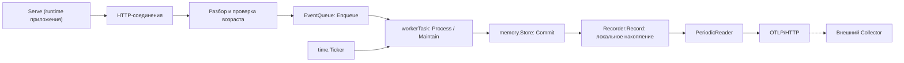

# Конкурентность и горутины user-login

Запуск обслуживают задача Serve приложения, файловый вход и один воркер модуля.
Отдельной задачи обслуживания нет: события и тики
обрабатываются одним циклом. Асинхронный путь события описан в
[приёме событий](async-ingest.md).

## Владение задачами

Задачу воркера запускает [`Module.StartWorker`](../backend/user-login/bootstrap/runtime.go):
операция выполняется в горутине, результат публикует [`Task.Complete`](../backend/pkg/task/task.go).
Ошибка дополнительно неблокирующе сигнализирует в `Module.Failed`. Задачей Serve
владеет [runtime приложения](../backend/cmd/user-login-httpserver/bootstrap/runtime.go):
`startServe` запускает горутину и сигнализирует об ошибке, результат публикуется `Task.Complete`.
Результат читается только после закрытия `Done`; истёкший бюджет
не позволяет дожидаться произвольную Go-функцию бесконечно.

| Задача | Владелец запуска | Назначение и завершение |
|---|---|---|
| задача Serve | [runtime приложения](../backend/cmd/user-login-httpserver/bootstrap/runtime.go) через `startServe` | Выполняет `http.Server.Serve`; при закрытии listener владельцем ожидаемые ошибки закрытия нормализуются в успех |
| `workerTask` | [`Module.StartWorker`](../backend/user-login/bootstrap/runtime.go) | Последовательно выполняет `Process` и `Maintain`; закрытая очередь дочитывается до конца, принудительная отмена прекращает планирование |

Главный [`run`](../backend/cmd/user-login-httpserver/bootstrap/runtime.go) ждёт отмены
контекста запуска, сигнала `Module.Failed` воркера или ошибки задачи Serve, затем
вызывает общую процедуру остановки. Внутренний сбой воркера закрывает приём
и останавливает сервис; предметный отказ только диагностируется.

`http.Server` также управляет горутинами соединений. Их количество зависит от трафика,
а не от числа собственных задач. `Shutdown` ожидает активные запросы, `Close` обрывает
соединения, но не может принудительно завершить выполняющийся Go-обработчик.

## Обработка и экспорт

HTTP-горутины не обращаются к состоянию сценариев. Они передают владение событием
[`EventQueue`](../backend/user-login/internal/infrastructure/queue/event_queue.go):
постановка под `RLock`, закрытие под `Lock`. Bootstrap передаёт воркеру только чтение
`Events()` и операцию `Close`, поэтому пакет воркера не импортирует очередь.
Блокировка не удерживается во время предметной обработки.

Единственный воркер вызывает [`LoginObserver`](../backend/user-login/internal/application/usecase/login_observer.go).
`Process` и `Maintain` не перекрываются. Обслуживание удаляет истёкшую историю и
закрывает ожидания даже без новых событий. Первый тик — через настроенный интервал;
занятая обработка может задержать следующий проход. Время предметных решений берётся
один раз в начале операции воркера. `memory.Store` не синхронизирует доступ и выдаёт
сценарии по ссылке: читать или изменять их из HTTP и других горутин нельзя.
Сборщик SDK работает только с накопленными измерениями, без доступа к сценариям.

Регистрация измерений синхронна и не выполняет сеть. Экспорт независимо организует
[`Pipeline`](../backend/pkg/otlpmetrics/internal/infrastructure/otel/pipeline.go) с одним
`PeriodicReader`: SDK собирает накопленные данные и вызывает OTLP/HTTP-экспортёр.
Это не утверждение о точном числе всех внутренних горутин SDK, HTTP-клиента или runtime.

## Остановка

[`shutdown`](../backend/cmd/user-login-httpserver/bootstrap/runtime.go) выдаёт один общий
бюджет, независимый от отмены запуска через `context.WithoutCancel`:

1. Закрывает listener и отключает планирование обслуживания.
2. Выполняет HTTP Shutdown, чтобы активные запросы завершили постановку.
3. Закрывает очередь для новых постановок; уже принятые события остаются для drain.
4. Ждёт задачу Serve и обработки остатка очереди воркером.
5. Передаёт оставшееся время [`Pipeline.Shutdown`](../backend/pkg/otlpmetrics/api/pipeline.go)
   для финального экспорта и очистки.

По истечении общего бюджета `context.AfterFunc` отменяет воркер. Следующие события
не начинают обрабатываться; уже выполняющуюся функцию отмена насильно не прерывает.
Отмена воркера владельцем не создаёт дополнительный `context.Canceled` в `taskErrors`,
но исчерпание бюджета и незавершённый drain остаются ошибкой остановки.
При неуспехе HTTP Shutdown соединения закрываются принудительно; поздний обработчик
не сможет отправить событие в закрытый канал.

Финальный экспорт — best effort, включая остановку с истёкшим контекстом. Даже
успешный локальный экспорт не доказывает доставку в Prometheus. Повторная остановка
возвращает сохранённый результат, без нового бюджета и повторной отправки.

## Границы проверки

[`worker_test.go`](../backend/user-login/internal/infrastructure/worker/worker_test.go)
проверяет FIFO, обслуживание, диагностику и отмену; тесты рядом с
[bootstrap модуля](../backend/user-login/bootstrap/bootstrap_test.go) — публикацию ошибок
фоновых задач и фазы drain; [`app_test.go`](../backend/cmd/user-login-httpserver/bootstrap/app_test.go) — настоящий
HTTP-приём, drain и бюджет остановки; [`app_otlp_test.go`](../backend/cmd/user-login-httpserver/bootstrap/app_otlp_test.go) —
экспорт в локальный получатель. Эти проверки не подтверждают живую интеграцию
МИС/Auth, Collector или Prometheus. Команды запуска — в [инструкции разработки](development.md).
