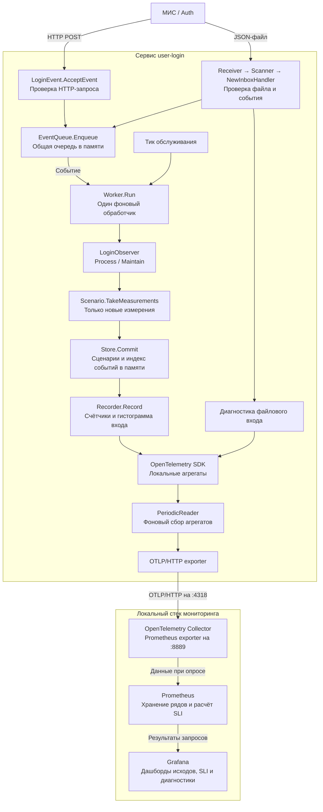

# Как собираются метрики входа в МИС

## 1. Назначение и границы

Сборщик `user-login` не выполняет вход. Он получает отдельные факты от МИС и Auth, связывает их по `scenario_id` и измеряет исход входа и длительность успеха. `event_id` нужен для поиска повторной доставки конкретного факта, а не для объединения сценария.

Карта описывает репозиторий Metrics, ветку `main`, ревизию `8161347`: Go-сервис и локальную конфигурацию Collector, Prometheus и Grafana. На момент чтения исходники соответствовали ревизии; локальные изменения касались документации и удаления строки комментария в [route.go](../backend/cmd/user-login-httpserver/bootstrap/route.go). Реализация отправки в МИС/Auth и рабочий внешний стенд не входят в карту. Форматы и правила событий: [спецификация](specs/login-observability.md) и [OpenAPI](specs/login-observability.openapi.yml).

## 2. Общая схема

Оба входа проверяют факт и передают его в одну очередь, чтобы сценарий можно было собрать из событий, доставленных разными способами.

```text
МИС / Auth (внешние отправители)
  ├─ HTTP POST → LoginEvent::AcceptEvent() → EventQueue::Enqueue()
  └─ JSON-файл → Receiver::Run() → Scanner::Scan()
       → callback из NewInboxHandler() → EventQueue::Enqueue()
EventQueue::Enqueue() → [общий канал в памяти]
```

Один фоновый обработчик применяет факты и закрывает истёкшие ожидания, чтобы зарегистрировать новые измерения.

```text
Worker::Run() [фоновая горутина]
  ├─ событие из канала → LoginObserver::Process()
  └─ тик обслуживания → LoginObserver::Maintain()

Оба пути при изменении сценария:
  Scenario::TakeMeasurements() → Store::Commit()
    → Recorder::Record() → [агрегаты OpenTelemetry SDK]
```

Накопленные метрики отправляются независимо от событий, а мониторинг сохраняет историю и рассчитывает показатели.

```text
[агрегаты OpenTelemetry SDK] → [фоновый PeriodicReader] → OTLP/HTTP exporter
  → [сеть: push OTLP] Collector → Prometheus exporter
  → [сеть: scrape] Prometheus → recording rules → Grafana
```

**Приняли факт ≠ обработали факт ≠ доставили метрики.** Даже успешная отправка в Collector не означает, что Prometheus уже опросил его.

## 3. Основные сценарии

### Приём по HTTP или из файла

**Вход:** `POST /metrics/b/user-login/events` с JSON либо обычный файл `<event_id>.json` с таким же JSON в каталоге файлового входа.

1. **HTTP.** [`routeOf()`][route] регистрирует POST и передаёт контроллеру `EventQueue.Enqueue`. [`rootHandler()`][root] собирает общий роутер через `httproute.NewRouter()`: handler модуля монтируется под `/`, поэтому внешний путь не меняется. [`LoginEvent::AcceptEvent()`][http] проверяет `Content-Type` и вызывает [`factory.DecodeEvent()`][decode]: он разбирает JSON и проверяет в том числе допустимый возраст `occurred_at`.
2. **Файл.** [`Module::StartInbox()`][module] запускает [`Receiver::Run()`][receiver]. Тот сканирует каталог при старте, затем по таймеру и подходящим уведомлениям файловой системы. [`Scanner::Scan()` / `deliver()`][scanner] проверяют файл и вызывают адаптер [`NewInboxHandler()`][inbox], зарегистрированный в [`inboxOf()`][wiring]. Адаптер использует тот же `DecodeEvent()` и тот же метод очереди. `mtime` влияет на порядок обработки и диагностику, но не заменяет `occurred_at`.
3. **Общая граница.** [`EventQueue::Enqueue()`][queue] ставит событие в буферизированный Go-канал без ожидания свободного места. [`Module::StartWorker()`][module] запускает [`Worker::Run()`][worker]; воркер получает канал этой очереди при [сборке модуля][wiring].

**Результат:** HTTP возвращает `202` без тела после постановки или `503 overloaded`, если очередь полна. В файловом входе при полной или закрытой очереди файл остаётся на следующий скан, где возраст проверяется снова. После успешной постановки или окончательного отказа приёмник пытается удалить файл: его исчезновение не отличает приём от отказа.

В [OpenAPI](specs/login-observability.openapi.yml) обработка описана как происходящая после ответа. В коде воркер уже может читать канал, пока HTTP-обработчик пишет `202`: гарантируется отсутствие ожидания обработки со стороны HTTP, а не порядок этих двух действий. Подробнее — в [описании асинхронного приёма](async-ingest.md).

### Из события в измерение

**Вход:** воркер извлёк из очереди проверенное событие. МИС сообщает о начале и успехе, Auth — о варианте `credentials` или `existing_session`; обе системы могут сообщить об окончательной технической ошибке или отказе.

1. [`Worker::Run()`][worker] вызывает [`LoginObserver::Process()`][observer]. `processEvent()` сначала удаляет закрытые записи с истёкшим хранением, затем проверяет `event_id`: тот же разобранный факт ничего не добавляет, изменённый факт с тем же ID даёт конфликт.
2. [`LoginObserver::Process()`][observer] находит или создаёт сценарий по `scenario_id`. `checkFact()` проверяет совместимость с первыми принятыми фактами. Если проверки и лимиты позволяют, `acceptFact()` вызывает один из методов [`Scenario`][scenario]: `Start()`, `DetermineMode()`, `Succeed()`, `Fail()` или `Reject()`.
3. [`Scenario::TakeMeasurements()`][measurements] выдаёт только ставшие доступными измерения и отмечает их выданными. [`Store::Commit()`][store] сохраняет ссылку на сценарий и копию нового события, после чего [`Recorder::Record()`][recorder] вызывает `Add` или `Record` в локальном SDK. Сетевого запроса здесь нет.

**Результат:** в памяти остаются факты и отметки об учёте, а в SDK — агрегаты. Метрики не содержат `scenario_id` и `event_id`. Один принятый факт может дать ноль, одно или два новых измерения.

| Инструмент OpenTelemetry | Когда появляется вклад |
| --- | --- |
| `mis.login.scenarios.completed` — счётчик по `outcome` | Когда впервые установлен `success`, `technical_error`, `rejected` или `unknown`. Начало и ожидающий сценарий сами по себе не считаются. |
| `mis.login.scenarios.technical_errors` — счётчик по `mode` | Когда известны и техническая ошибка, и вариант входа. Начало не требуется. |
| `mis.login.scenario.duration` — гистограмма по `mode` | Когда известны начало, успех и вариант. Это `occurred_at` успеха минус `occurred_at` начала, в секундах. Ноль допустим; отрицательная длительность логируется и не попадает в гистограмму, но исход остаётся `success`. Явные границы — 5, 30 и 60 секунд. |

Например, МИС сообщила об успехе раньше, чем дошло событие Auth: общий счётчик уже увеличится, а гистограмма — только при получении варианта.

```text
Один scenario_id, запись ещё хранится:
login_started (12:00:00) → Scenario::Start()         → новых измерений нет
login_succeeded (12:00:06) → Scenario::Succeed()     → completed{outcome="success"} +1
login_mode_determined   → Scenario::DetermineMode() → duration{mode="credentials"}: 6 с
```

Повтор этих фактов не увеличит счётчики и не добавит наблюдение. Если вариант поступит после `login_failed`, пополнится только счётчик ошибок по варианту: завершение уже учтено. В [тесте порядка фактов][measurement-tests] перечислены все перестановки начала, варианта и исхода.

### Закрытие по сроку без финального события

**Вход:** тик обслуживания (по умолчанию раз в секунду) или обработка факта.

1. По тику [`Worker::Run()`][worker] вызывает [`LoginObserver::Maintain()`][observer]: тот удаляет истёкшие записи и перебирает оставшиеся. На пути `Process()` проверка срока идёт после дедупликации и проверки конфликта факта. Оба пути выполняются последовательно одним воркером.
2. [`Scenario::CloseIfExpired()`][scenario] выставляет `unknown`, если исхода ещё нет и текущее время обработки достигло срока ожидания: 15 минут от `occurred_at` начала, а без начала — от времени Go при обработке первого принятого факта. Если впервые принятое начало уже просрочено, `Scenario::Start()` может закрыть ожидание сразу.
3. Воркер проводит закрытие через тот же путь `TakeMeasurements()` → `Commit()` → `Record()`. На пути `Process()` закрытие может дать вклад в `unknown`, даже если новый факт затем отклонён.

**Результат:** появляется одно завершение `outcome="unknown"`. Опоздавший успех не меняет его, даже если его `occurred_at` раньше срока. Через 15 минут после фиксации любого исхода запись и её `event_id` подлежат удалению при ближайшем обслуживании или обработке события. Это не уменьшает уже накопленные метрики.

### От SDK до графиков

**Вход:** на старте [`App::startTelemetry()`][runtime] вызывает [`Pipeline::Start()`][pipeline], затем [`Module::Start()`][module]. Provider создаётся с одним `PeriodicReader` и [настройкой границ гистограммы][recorder]; модуль активирует предметные инструменты и диагностику файлового входа в одном meter.

1. **Go → Collector.** `PeriodicReader` собирает агрегаты самого SDK, не читая сценарии и не вызывая `Maintain()`. Экспортёр из [`Pipeline::Start()`][pipeline] отправляет их по OTLP/HTTP на настроенный endpoint. [Пример окружения](../.env.example) для локального стенда задаёт интервал 10 с и `cumulative`: пакеты несут накопленные значения, не список событий. В коде эти два значения не зафиксированы, их читает SDK. При ошибке отправки [адаптер][exporter] пишет безопасный лог; в режиме `cumulative` следующий успешный экспорт переносит актуальные итоги живого процесса.
2. **Collector → Prometheus.** По [конфигу Collector](../docker/otel-collector/config.yaml) OTLP/HTTP принимается на `4318`, а Prometheus exporter отдаёт серии на `8889`. Для `service.name=mis-login-observability` процессор копирует `host.name` и `deployment.environment.name` из Resource в labels `node` и `environment`, если атрибуты доступны. Здесь же имена из OTLP преобразуются в Prometheus-форму, например `mis.login.scenarios.completed` → `mis_login_scenarios_completed_total`.
3. **Prometheus → Grafana.** [Prometheus](../docker/prometheus/prometheus.yml) опрашивает Collector раз в 60 с и применяет [recording rules](specs/login-observability.prometheus.rules.yml), которые [Compose](../docker-compose.grafana.yml) монтирует в контейнер. Правила считают приросты за скользящий час по ноде и окружению: общий SLI использует успехи и технические ошибки, а детальные — число наблюдений гистограммы, корзины ≤ 30 с (`credentials`) или ≤ 5 с (`existing_session`) и отдельный счётчик ошибок. `rejected` и `unknown` не входят в SLI. [Графики исходов](../docker/grafana/dashboards/auth.json) и [графики SLI и длительностей](../docker/grafana/dashboards/login-journey.json) запрашивают ряды Prometheus.

**Результат:** Go регистрирует исходные измерения, Prometheus хранит временные ряды и рассчитывает показатели, Grafana их показывает. На старте [`Recorder::Activate()`][recorder] создаёт шесть нулевых рядов счётчиков, но гистограмма появляется только после настоящего наблюдения. Если первый scrape уже увидел ненулевой счётчик, предыдущий прирост не восстановить из этого отсчёта. Нулевой знаменатель SLI — отсутствие результата, а не 100%.

### Диагностика файлового входа

**Вход:** сканирование каталога или результат операции с публикацией. Это отдельные метрики, не измерения качества входа в МИС.

1. [`Scanner::Scan()`][scanner] снимает состояние каталога до обработки пачки и обновляет [диагностические инструменты][diagnostics]: число и размер файлов, возраст старейшего файла по `mtime`, долю занятых блоков тома. Отдельный счётчик отмечает постановки в очередь, отложенные попытки, невалидные публикации и ошибки файловых операций.
2. Инструменты активирует [`Receiver::ActivateMetrics()`][receiver] из `Module::Start()`. Они используют тот же SDK и путь экспорта, что и метрики сценария.

**Результат:** [дашборд файлового входа](../docker/grafana/dashboards/file-inbox.json) и [правила оповещений](../docker/prometheus/file-inbox.rules.yml) используют эти ряды независимо от SLI. Диагностический `accepted` считает постановки файловых событий в очередь, а не успешные входы пользователей.

## 4. Что важно при чтении кода

- **Три разных времени.** Допустимый возраст факта проверяется на входе. Срок ожидания оценивается по часам Go в начале обработки, поэтому ожидание в очереди может повлиять на исход, хотя возраст не проверяется повторно. Для успешной длительности используются только исходные времена МИС.
- **Одна очередь, одно состояние на процесс.** Лимит постановки в [`EventQueue`][queue] и лимиты сценариев в [`Store::CheckCapacity()`][store] — разные проверки. Конфликт, истечение срока и исчерпание лимита хранилища диагностируются воркером и не меняют `202`. Состояние не разделяется между экземплярами: факты одного сценария должны попасть в один процесс.
- **Нет общей транзакции или гарантии доставки.** Сценариями владеет только воркер; SDK читает своё накопление, поэтому счётчик и гистограмма могут отразить одну операцию в соседних сборах. При перезапуске очередь, дедупликация и агрегаты теряются. При штатной остановке [`App::shutdown()`][runtime] прекращает приём, ждёт обработки очереди и вызывает [`Pipeline::Shutdown()`][pipeline] с остатком общего бюджета. Последний экспорт — best effort, а не гарантия сохранения в Prometheus.

## 5. С чего начать чтение

1. [`main()`](../backend/cmd/user-login-httpserver/main.go) → [`bootstrap.Run()` / `newApp()`](../backend/cmd/user-login-httpserver/bootstrap/app.go) — точка запуска и сборка зависимостей.
2. [`LoginEvent::AcceptEvent()`][http] и [адаптер `NewInboxHandler()`][inbox] — где событие входит в общую очередь.
3. [`LoginObserver::Process()` / `Maintain()`][observer] и [`Scenario::TakeMeasurements()`][measurements] — когда факт превращается в измерение.
4. [`Store::Commit()`][store] → [`Recorder::Record()`][recorder] → [`Pipeline::Start()`][pipeline] — где измерение записывается и кто его отправляет.
5. [Локальная цепочка Collector → Prometheus → Grafana](../docker/otel-collector/README.md) — конфигурация стенда и границы приёмки интеграции.

**Что не подтверждено этой картой.** Маршруты и вызовы проверены чтением исходников, тестов и конфигурации. [Тесты приложения][otlp-tests] описывают смешанный приём, восстановление экспорта и финальную отправку через локальный HTTP-получатель; тесты здесь не запускались. Для подтверждения работы отправителей нужны код или наблюдение за МИС/Auth. Для проверки фактических рядов, labels и SLI во внешнем pipeline нужны его развёрнутая конфигурация и проверка на живом стенде.

## 6. Сводная диаграмма

Оба входа передают факты одному воркеру, а мониторинг получает уже накопленные измерения, а не события.



[route]: ../backend/user-login/bootstrap/route.go
[root]: ../backend/cmd/user-login-httpserver/bootstrap/route.go
[http]: ../backend/user-login/internal/presentation/http/controller/login_event.go
[decode]: ../backend/user-login/internal/application/factory/event.go
[module]: ../backend/user-login/bootstrap/runtime.go
[receiver]: ../backend/pkg/fileinbox/internal/presentation/receiver/receiver.go
[scanner]: ../backend/pkg/fileinbox/internal/application/usecase/scanner.go
[inbox]: ../backend/user-login/internal/presentation/listener/inbox_handler.go
[wiring]: ../backend/user-login/bootstrap/app.go
[queue]: ../backend/user-login/internal/infrastructure/queue/event_queue.go
[worker]: ../backend/user-login/internal/infrastructure/worker/worker.go
[observer]: ../backend/user-login/internal/application/usecase/login_observer.go
[scenario]: ../backend/user-login/internal/domain/scenario/scenario.go
[measurements]: ../backend/user-login/internal/domain/scenario/measurements.go
[store]: ../backend/user-login/internal/infrastructure/memory/store.go
[recorder]: ../backend/user-login/internal/infrastructure/otel/recorder.go
[measurement-tests]: ../backend/user-login/internal/domain/scenario/measurements_test.go
[runtime]: ../backend/cmd/user-login-httpserver/bootstrap/runtime.go
[pipeline]: ../backend/pkg/otlpmetrics/internal/infrastructure/otel/pipeline.go
[exporter]: ../backend/pkg/otlpmetrics/internal/infrastructure/otel/exporter.go
[diagnostics]: ../backend/pkg/fileinbox/internal/infrastructure/otel/diagnostics.go
[otlp-tests]: ../backend/cmd/user-login-httpserver/bootstrap/app_otlp_test.go
