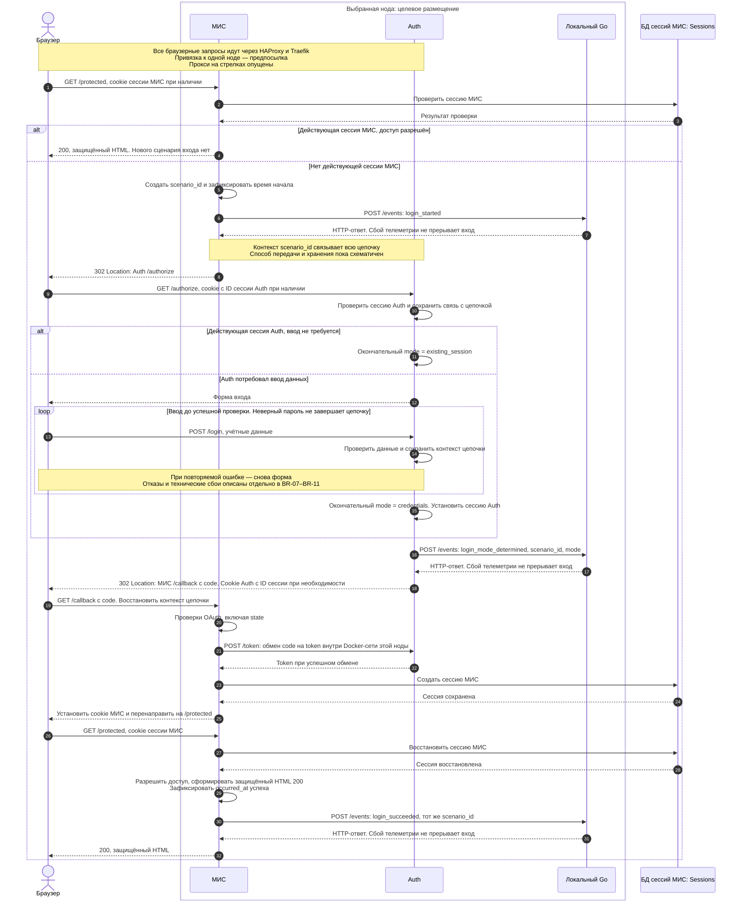
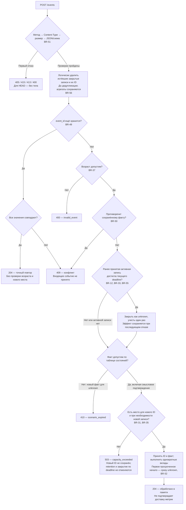

# Наблюдаемость сценария входа в МИС

- Статус: **согласовано**.
- Редакция: 0.29.
- Основание: решения пользователя в текущем обсуждении.
- Документ и комплект приложений согласованы пользователем целиком.
  Разработка разрешена в рамках отдельных обучающих задач с разбором и приёмкой каждого шага.
- Комплект, редакция 0.29:
  [OpenAPI](login-observability.openapi.yml),
  [расчёты Prometheus](login-observability.prometheus.rules.yml),
  [тесты правил Prometheus](login-observability.prometheus.test.yml),
  [проверка артефактов](check_login_observability.py).
  Формулы не изменялись; номер комплекта синхронизирован. OpenAPI 3.1.1 — версия формата
  описания; поле версии в событиях не используется.

В редакции 0.29 по решению пользователя убраны поле версии событий, ограничения
версии и строковой формы UUID и дополнительная строгость JSON. Для `mode`
отсутствие, `null` и `""` равнозначны; непустой вариант нужен только у `login_mode_determined`.

Согласованные технические решения задачи 08, включая пересмотр накопления измерений,
Fx, Resource, конфигурацию и жизненный цикл экспорта, вынесены в
[техническое дополнение](login-observability-implementation.md).
Оно конкретизирует OQ-10; текущие правила входных событий определены этим документом.

## 1. Цель и границы

На реальном локальном сценарии авторизации научиться проектировать измерения по принципу:
**сначала вопрос, затем правила измерения, тип метрики, labels и способ сбора**.

Новый сервис на Go принимает факты от МИС и Auth, связывает их в сценарии и формирует метрики.

Входит:

- Новый вход в МИС, включая редиректы, возможный ввод данных и получение защищённой страницы.
- Три показателя качества и их SLO.
- Расчёт этих трёх SLO отдельно для каждой ноды; общий SLO всей инсталляции пока не вводится.
- Основной контракт измерений на OpenTelemetry/OTLP, независимо от хранилища метрик;
  Prometheus — текущее представление и место расчёта, а не обязательный API Go-сервиса.
- Однократная доставка событий, хранение в памяти и экспорт через существующий Collector.
- Правила частичных данных, повторов и ограничения памяти.
- Общие требования к МИС и Auth как внешним отправителям событий, без проектирования их доработок.
- Схема размещения: один локальный экземпляр Go на каждой ноде, в Docker-сети с МИС и Auth,
  как на локальном стенде, так и в production.

Не входит:

- Реализация аутентификации, проверка паролей, OAuth-кодов, `state` и прав в Go-сервисе.
- Доставка HTML браузеру, загрузка ресурсов, JS, отрисовка и frontend-телеметрия.
- Дальнейшая стабильность уже существующей сессии МИС.
- Гарантированная доставка, Redis, сохраняемые очереди, восстановление после перезапуска.
- HA, балансировка между экземплярами Go, общее состояние и перенос сценариев между нодами;
  фактическая проверка четырёх production-нод.
- Конкретные дашборды для исключённых исходов, alerting и Error Budget Policy.
- Общий SLO по всем нодам инсталляции; его добавление возможно позднее на основе агрегатов.
- Устройство и эксплуатация Go-сервиса: версия Go, библиотеки, пакеты, сборка,
  health endpoint, выбор собственного логирования и численные timeout остановки.
  Эти вопросы обсуждаются отдельно; сейчас определяются API и общие требования интеграций.
- Проектирование и реализация доработок МИС/Auth: точки инструментирования, хранение
  контекста цепочки, передача идентификатора через OAuth и изменения PHP-кода.
  Эта работа обсуждается отдельно и не блокирует разработку Go-сервиса по контракту.

Локально МИС и Auth работают на одной ноде. По подтверждению пользователя, при действующей
PHP-сессии МИС использует существующую авторизацию без редиректов в Auth. Существующая
сессия Auth не отменяет OAuth-цепочку: МИС всё равно получает и проверяет `code`.

## 2. Вопросы, показатели и SLO

Обозначения:

- `S` — число зарегистрированных успешных сценариев.
- `E` — число зарегистрированных сценариев с технической ошибкой.
- `S_m`, `E_m` — те же количества для определённого варианта входа `m`.
- `F_m` — успешные сценарии варианта `m`, завершённые не позже его порога.

Все количества в формулах ниже относятся к **одной выбранной ноде и окружению**.
Три SLO рассчитываются независимо на каждой ноде, без смешивания трафика разных нод
и без усреднения их процентов. Общий показатель успешности (SLI-01) означает
«по всем вариантам входа этой ноды», а не «по всем нодам».

| ID     | Вопрос                                                            | SLI                 | SLO                            |
|--------|-------------------------------------------------------------------|---------------------|--------------------------------|
| SLI-01 | Какая доля учитываемых входов успешна?                            | `S / (S + E)`       | Не менее 90% за скользящий час |
| SLI-02 | Какая доля учитываемых входов с вводом данных успешна за ≤ 30 с?  | `F_m / (S_m + E_m)` | Не менее 90% за скользящий час |
| SLI-03 | Какая доля учитываемых входов через сессию Auth успешна за ≤ 5 с? | `F_m / (S_m + E_m)` | Не менее 90% за скользящий час |

Для детальных SLI успешные сценарии без известной длительности исключаются и из числителя,
и из знаменателя. Ошибка с известным вариантом входит в знаменатель без длительности.
Штатные отказы и неизвестные результаты исключаются из всех трёх SLI.
При нулевом знаменателе — **нет данных**, не 100%.
На малом числе сценариев процент может резко колебаться; минимальный объём выборки
пока не установлен. Отсутствие данных, в том числе из-за недоступности ноды или pipeline,
не подтверждает выполнение SLO; контроль доступности телеметрии — отдельная задача.

Смысл общей успешности и своевременности различается: медленный успех хорош для SLI-01,
но плох для SLI-02 или SLI-03. Исключение неизвестных исходов может скрыть реальные проблемы;
показатели характеризуют зарегистрированные данные, а не гарантированно все входы.

### Время и окно

Полная длительность — время между началом входа в МИС и успешным формированием защищённой
страницы. Она включает серверную обработку, ввод данных, паузы пользователя, сеть и редиректы.
Это не чистое серверное время обработки.

Время возникновения фактов передают приложения; время получения Go фиксирует отдельно.
Для успешной длительности обе исходные временные метки поступают от МИС.

Согласован учёт по завершениям, а не по началам. Для первой версии допускается приближение:
часовое окно рассчитывает мониторинг по зарегистрированным агрегированным метрикам.
Это не точное распределение завершений по их исходным временным меткам.
Позднее дополнение данных также становится видимо в момент регистрации метрики.

## 3. Правила сценария

| ID    | Условие и результат                                                                                                                                                                                                                                                                                                                                              |
|-------|------------------------------------------------------------------------------------------------------------------------------------------------------------------------------------------------------------------------------------------------------------------------------------------------------------------------------------------------------------------|
| BR-01 | Начало — МИС обнаружила отсутствие действующей сессии и инициирует авторизацию.                                                                                                                                                                                                                                                                                  |
| BR-02 | Действующая сессия МИС позволяет сразу открыть защищённую страницу; нового сценария входа нет.                                                                                                                                                                                                                                                                   |
| BR-03 | Независимо начатые цепочки, в том числе в разных вкладках, — разные сценарии. Вкладка сама по себе не создаёт вход.                                                                                                                                                                                                                                              |
| BR-04 | Редиректы и повторные вводы пароля одной цепочки относятся к одному сценарию и не сбрасывают его начало. Повтор login_started с тем же scenario_id и временем начала — 204 без изменений, в том числе с другим event_id. Другое время начала для того же scenario_id — 409; первоначальное начало сохраняется.                                                   |
| BR-05 | Вариант определяется фактическим поведением Auth, а не скоростью входа. Если ввод данных потребовался хотя бы раз, это вариант с вводом данных. Auth сообщает окончательный вариант, не предварительное предположение. Первый принятый вариант неизменяем; повтор того же варианта — 204 без изменений, другой вариант — 409 без изменения записи или агрегатов. |
| BR-06 | Успех — в последующем запросе МИС восстановила сессию, разрешила доступ и успешно сформировала защищённый HTML с HTTP 200. Callback, редирект, форма входа или страница ошибки с 200 — не успех.                                                                                                                                                                 |
| BR-07 | Подтверждённый технический сбой, прервавший цепочку, завершает её технической ошибкой.                                                                                                                                                                                                                                                                           |
| BR-08 | Ошибка проверки OAuth-кода или `state` — техническая ошибка.                                                                                                                                                                                                                                                                                                     |
| BR-09 | Если после callback сессия не восстановилась и МИС снова перенаправляет на вход, текущий сценарий завершается технической ошибкой.                                                                                                                                                                                                                               |
| BR-10 | Окончательный отказ из-за отсутствия прав или отключённой учётной записи — штатный отказ, вне SLO.                                                                                                                                                                                                                                                               |
| BR-11 | Неверный пароль с возможностью повторного ввода не завершает сценарий.                                                                                                                                                                                                                                                                                           |
| BR-12 | Для сценария с известным началом deadline равен исходному времени начала плюс 15 минут. Если окончательный исход ещё не установлен, при текущем времени Go ≥ deadline сценарий закрывается как «результат не установлен». Проверка выполняется при обработке события и фоновом закрытии; повторный ввод срок не продлевает.                                      |
| BR-13 | Закрытый исход окончателен; позднее завершение не меняет его, даже если его occurred_at раньше deadline. Это ограничение измерения, не запрет пользователю продолжить вход.                                                                                                                                                                                      |
| BR-14 | У одного сценария не более одного окончательного исхода. Среди login_succeeded/login_failed/login_rejected сохраняется первый принятый исход; подтверждение того же исхода возвращает 204 без повторного учёта, противоречащий исход — 409 без изменения записи или агрегатов. Повторы событий и обновление страницы не добавляют завершений.                    |
| BR-15 | Пороги 30 и 5 секунд включительны. Это пороги качества, не сроки закрытия сценария.                                                                                                                                                                                                                                                                              |

### Срок ожидания и поздняя доставка — решение OQ-01

Согласовано закрытие по сроку ожидания без последующего пересмотра.
Проверка текущего времени Go и установка окончательного исхода выполняются как одна
неделимая операция относительно конкурирующих обработчиков и фонового закрытия.
Время для проверки получают внутри этой операции, а не при получении HTTP-запроса.

- При текущем времени Go < deadline окончательное событие можно принять.
- При текущем времени Go ≥ deadline сценарий без исхода закрывается как неизвестный,
  независимо от того, успел ли сработать фоновый обработчик.
- Уже принятый до deadline окончательный исход не заменяется неизвестным.
- Исходное время событий используется для длительности принятого успеха, но не позволяет
  пересмотреть закрытие по сроку ожидания.

Например: начало в 12:00:00, успех произошёл в 12:14:59, но обрабатывается Go в 12:15:00.200.
Если исход ещё не установлен, результат — неизвестный, вне SLO. Это принятая погрешность
доставки, не доказательство неуспешного входа пользователя.
Для сценариев с неизвестным началом действует BR-33. Позднее окончательное событие
после закрытия как неизвестного получает 410 по BR-48.

### Повторы и противоречивые факты — решение OQ-02

Для `login_succeeded`, `login_failed` и `login_rejected` побеждает первый исход,
принятый Go в неделимой операции проверки и изменения сценария. При конкурентной обработке
не гарантируется, какой обработчик победит, но итог один: победившее событие получает 204,
противоречащее — 409. Более раннее `occurred_at` другого события не меняет принятый исход.

Подтверждение того же исхода, в том числе с другим `event_id`, возвращает 204,
не заменяет исходное окончательное событие и не создаёт повторного завершения или наблюдения
длительности. Проверка повторного `event_id` с изменённым содержимым сохраняет приоритет:
такой запрос получает 409 даже при совпадении исхода.

Для повторного `login_started` с тем же `scenario_id` и временем начала возвращается 204
без изменения начала или deadline, даже если `event_id` другой. Другое время начала
для этого `scenario_id` даёт 409 без изменений. При конкуренции разных начал сохраняется
первое принятое; совпадение времени определяется по моменту времени. Текущий wire-формат
допускает только UTC с Z и миллисекундами. Проверка изменённого содержимого уже принятого `event_id`
также применяется к началу и возвращает 409.

Правила действуют, пока запись хранится в памяти (BR-29–BR-30).
Окончательное событие, пришедшее после закрытия как неизвестного,
получает 410 по BR-48, а не 409 для противоречия двум зарегистрированным исходам приложений.

## 4. Ответственность и архитектура

```text
МИС / Auth
    │ POST /events: синхронно, один раз, общий timeout 1 с
    ▼
Новый Go-сервис: сценарии, дедупликация, агрегаты — в памяти
    │ периодический экспорт метрик по OTLP/HTTP
    ▼
Существующий OpenTelemetry Collector
    ▲ периодический сбор метрик
    │
Prometheus: история и расчёт SLI → Grafana
```

- МИС сообщает начало, успех и обнаруженные окончательные ошибки/отказы.
- Auth сообщает вариант входа и обнаруженные окончательные ошибки/отказы.
- Go связывает факты, рассчитывает длительность, ведёт исход и формирует агрегаты.
- Мониторинг для каждой ноды отдельно рассчитывает скользящий час и сравнивает три SLI с целью 90%.
- Go не принимает решений о доступе пользователя.

### Размещение и граница доверия — решение OQ-08

Локально и в production на каждой ноде работает один экземпляр Go-сервиса в общей
Docker-сети с МИС и Auth этой ноды. HTTP API доступен только внутри этой сети:
без публикации порта на хост, маршрута Traefik и отдельной HTTP-аутентификации.
Поле `source` проверяется по контракту, но не удостоверяет личность отправителя.
Любой участник сети с доступом к API технически может отправлять события;
доверие к этой сети — явная предпосылка эксплуатации, включая production.

У экземпляров нет общей памяти или репликации. Для полноты цепочки все её события
должны попасть в один экземпляр Go; доставка частей цепочки на разные ноды даст
неполные записи, которые не объединяются автоматически. Обеспечение этой связи —
общее требование к последующей интеграции, без выбора механизма МИС/Auth здесь.
Остановка ноды или Go теряет её состояние согласно BR-32.

Метрики экземпляров должны различаться в pipeline. Идентичность ноды передаётся Go
через env-конфигурацию: уникальна внутри инсталляции и стабильна при перезапуске контейнера.
Окружение задаётся отдельно, чтобы локальные и production-данные не смешивались.
Это Resource-атрибуты источника, не поля событий МИС/Auth. Их ключи и требуемое
отображение в labels определены в разделе 8; конкретные имена env-настроек
и формирование ID экземпляра обсуждаются отдельно в OQ-10.
Общий SLO инсталляции не вводится; расчёт выполняется отдельно для каждой ноды.
Наличие такой схемы в спецификации не означает проведённую проверку production-развёртывания.

Используется существующая инфраструктура `sptr/config/otel-collector`.
На момент чтения конфигурации OTLP/HTTP принимается на `4318`, Prometheus-exporter доступен
на `8889`, Prometheus опрашивает `otel-collector:8889` каждые 60 секунд.
Это сведения о конфигурации файлов, не подтверждение работающего deployment.
Go экспортирует метрики каждые 10 секунд; интервал настраивается. Существующий интервал
сбора Prometheus 60 секунд не меняется. Отдельный `/metrics` в Go не требуется.

### МИС, браузер и Auth: обзор последовательности

Схема ниже объединяет описание существующего входа из исходного
обсуждения архитектуры и планируемую отправку событий
по текущему контракту. Это обзор успешного пути, не проект реализации МИС/Auth.
По уточнению пользователя, cookie сессии Auth содержит **только ID сессии**, не её данные;
конкретное серверное хранилище Auth здесь не определяется. Сессия МИС хранится отдельно
в БД, в таблице Sessions.

**Сейчас:** серверный запрос МИС → Auth выполняется через внешний адрес.
**К запуску сбора метрик, по решению пользователя:** этот запрос должен идти напрямую
к Auth той же ноды внутри Docker-сети. На диаграмме показан именно этот целевой маршрут,
а не уже проверенное развёртывание. Браузерные переходы остаются внешними:
браузер → HAProxy → Traefik → МИС или Auth. По описанию пользователя, cookie-привязка
HAProxy направляет их на одну ноду; её фактическую работу ещё требуется проверить.
Внутренний обмен code → token сам по себе не гарантирует полноту измерения:
все события цепочки должны также поступать в один локальный Go по BR-39.

Все пути МИС/Auth ниже — **условные обозначения для последующей замены пользователем**:

| Условный endpoint | Назначение |
|-------------------|------------|
| МИС `/protected` | Защищённая страница |
| Auth `/authorize` | Начало OAuth-авторизации или использование сессии Auth |
| Auth `/login` | Ввод и проверка учётных данных |
| МИС `/callback` | Возврат браузера с authorization code |
| Auth `/token` | Серверный обмен code → token |

`POST /events` Go — действительный путь согласованного контракта, не placeholder.
Сохранение и передача контекста `scenario_id` показаны **логически**: диаграмма не выбирает
query-параметр, cookie, header, session storage или иной механизм. `scenario_id` не заменяет
OAuth `state`, не даёт права доступа; проверки OAuth сохраняются. Конкретный способ связи
должен сохранять независимость цепочек, включая разные вкладки, по требованиям раздела 5.



Отправка каждого события синхронная, однократная, с общим timeout 1 с по BR-21–BR-24;
стрелки ответов Go не обещают 204 при любом запросе. Секреты, cookie, code и token,
участвующие в авторизации, не передаются в Go. Время успеха фиксируется до ожидания
ответа Go (BR-18). Callback и создание сессии ещё не являются успехом измеряемого
сценария: он подтверждается в последующем запросе защищённой страницы по BR-06.
Показанный порядок — иллюстрация успешного пути; Go обязан обрабатывать и иной порядок
доставки фактов по BR-25. Точные точки инструментирования и механизм контекста
остаются за охватом; эта схема их не утверждает и не разрешает доработки приложений.

## 5. Контракт событий: согласованная семантика

| Тип                     | Источник         | Дополнительные данные             |
|-------------------------|------------------|-----------------------------------|
| `login_started`         | `mis`            | Нет                               |
| `login_mode_determined` | `auth`           | Вариант входа                     |
| `login_succeeded`       | `mis`            | Нет                               |
| `login_failed`          | `mis` или `auth` | Обязательный код причины не нужен |
| `login_rejected`        | `mis` или `auth` | Обязательный код причины не нужен |

Обязательные общие поля: `event_id`, `scenario_id`, `occurred_at`, `source`, `type`.

| Поле          | Согласованный формат                                                                                                |
|---------------|---------------------------------------------------------------------------------------------------------------------|
| `scenario_id` | UUID без ограничения версии; создаётся МИС при начале нового сценария                                               |
| `event_id`    | UUID без ограничения версии; создаётся отправителем для нового события                                              |
| `occurred_at` | RFC 3339, UTC, точность до миллисекунд; пример: `2026-10-31T12:00:00.123Z`                                          |
| `source`      | `mis` или `auth`, с проверкой допустимости источника для типа события                                               |
| `type`        | Один из пяти типов из таблицы выше                                                                                  |
| `mode`        | Для `login_mode_determined`: `credentials` или `existing_session`; для остальных отсутствие, `null` или `""`          |

`credentials` означает, что Auth потребовал ввод учётных данных (порог 30 секунд).
`existing_session` означает использование действующей сессии Auth без ввода данных
(порог 5 секунд). Значение `unknown` не передаётся: неопределённость — отсутствие факта
определения варианта в Go, а не третий вариант в событии.

UUID используется только как идентификатор, ограничений версии и variant нет.
Время факта берётся из `occurred_at`, не извлекается из UUID. Порядок UUID не определяет
победивший окончательный исход. Допустимый возраст событий и обработка отрицательной
длительности определены в BR-37–BR-38.

| ID    | Правило                                                                                                                                       |
|-------|-----------------------------------------------------------------------------------------------------------------------------------------------|
| BR-16 | МИС создаёт UUID для нового сценария. Все участники цепочки используют его. Это не пользователь, сессия, OAuth-код, токен или `state`.        |
| BR-17 | Каждое событие имеет отдельный UUID, созданный отправителем. Повтор сохраняет ID, исходное время и содержимое.                                |
| BR-18 | Время события фиксируется до отправки. Время успеха — после формирования защищённой страницы; ожидание ответа Go не добавляется к этой метке. |
| BR-19 | Секреты, cookies и пользовательские данные в контракт не входят. Идентификаторы событий и сценариев не становятся labels метрик.              |
| BR-20 | Go назначает неизвестный результат самостоятельно; приложения не отправляют его отдельным событием.                                           |

### Общие требования к МИС и Auth

МИС и Auth рассматриваются как внешние отправители. В текущей спецификации требуется:

- МИС создаёт новый `scenario_id` для новой цепочки; все её участники используют один ID.
- Независимые цепочки не перезаписывают контекст друг друга, в том числе в разных вкладках.
- Все события одной цепочки направляются в один экземпляр Go; части цепочек на разных
  нодах автоматически не объединяются. Механизм обеспечения этого обсуждается отдельно.
- Связь сохраняется при редиректах, показе формы и повторном вводе учётных данных.
- События отражают факты и границы из BR-01–BR-20; Auth сообщает окончательный вариант.
- Исходные временные метки формируются по согласованным часам и отвечают BR-37.
- Отправка и безопасное штатное логирование соответствуют BR-21–BR-24.
- Передача идентификатора не ослабляет проверки OAuth `state`, не даёт права доступа
  и не раскрывает секреты в телеметрии.

Выбор способа передачи и хранения `scenario_id`, точек инструментирования и изменений
МИС/Auth вынесен в отдельное обсуждение. Здесь механизм не предписывается.
Go обрабатывает события по контракту и не должен зависеть от выбранного PHP-механизма.

### HTTP

`POST /events`, `Content-Type: application/json`, один JSON-объект в UTF-8.
Параметры MIME-типа допустимы, например application/json; charset=utf-8.
Неизвестные поля игнорируются. Источник должен соответствовать типу.
Невалидный запрос не изменяет сценарии или бизнес-агрегаты.
Основное место схем полей и примеров — [OpenAPI](login-observability.openapi.yml).
Динамическое состояние, время и приоритет ответов определяются таблицами ниже:
проверки схемы не заменяют правила сценария.

| Ответ | Код error                | Семантика                                                                                                                                                 |
|-------|--------------------------|-----------------------------------------------------------------------------------------------------------------------------------------------------------|
| 204   | Нет тела                 | Событие обработано в памяти текущего процесса либо подтверждён повтор без повторного учёта                                                                |
| 400   | `invalid_event`          | Невалидное событие, включая недопустимый возраст нового event_id                                                                                          |
| 405   | `method_not_allowed`     | Неподдерживаемый метод; также заголовок Allow: POST                                                                                                       |
| 409   | `event_conflict`         | Содержимое сохранённого event_id изменено либо факт противоречит сохранённому началу, варианту или окончательному исходу. Запись и агрегаты не изменяются |
| 410   | `scenario_expired`       | Новый факт не принимается после закрытия как unknown. Неизменённый известный факт — 204, противоречие — 409 по применимому приоритету проверок            |
| 413   | `payload_too_large`      | Превышен лимит тела, первоначально 4096 байт                                                                                                              |
| 415   | `unsupported_media_type` | Неподдерживаемый Content-Type                                                                                                                             |
| 503   | `capacity_exceeded`      | Допустимое событие не помещается в лимит сценариев или событий записи                                                                                     |
| 500   | `internal_error`         | Неожиданная внутренняя ошибка обработки                                                                                                                   |

Начальные проверки по BR-51: метод → Content-Type → размер тела → JSON и схема.
Например, неподдерживаемый Content-Type получает 415 даже при невалидном JSON.

Все ответы об ошибках с телом имеют Content-Type application/json и один строковый код:

```json
{"error":"event_conflict"}
```

Полей message, details, scenario_id и event_id в теле ошибки нет. Исходное тело события,
секреты и текст исключения не возвращаются. Разные нарушения схемы не дробятся на отдельные
коды 400. Отправитель сопоставляет ответ с известными ему ID и логирует по BR-24.
Успех 204 не имеет тела. Retry не выполняется ни для одного из ответов.
Протокольное исключение: ответ на HEAD /events — 405 с Allow: POST, но без тела
по [RFC 9110 §9.3.2](https://www.rfc-editor.org/rfc/rfc9110.html#section-9.3.2).

### Представление и равенство событий

Событие — один объект с пятью вариантами, различаемыми полем type; поля версии нет.
UUID принимаются в представлениях, поддерживаемых `github.com/google/uuid.Parse`:
с дефисами, 32 hex-символа, в фигурных скобках или URN; регистр hex несущественен.
occurred_at — календарно корректная дата UTC, ровно три знака миллисекунд и суффикс Z.
Достаточно успешного `time.Parse` с шаблоном `2006-01-02T15:04:05.000Z`:
принимается также запятая перед миллисекундами, обратное форматирование не проверяется.
Порядок полей, JSON-пробелы и эквивалентное экранирование строк не меняют событие.
Разбор выполняется обычным `encoding/json.Unmarshal`: имена полей сопоставляются
без учёта регистра, неизвестные поля игнорируются, при повторении строкового поля
остаётся последнее значение. Дополнительные JSON-значения после объекта отклоняются с 400.
Для `mode` отсутствие, `null` и пустая строка равнозначны отсутствию варианта;
у `login_mode_determined` вариант по-прежнему обязателен.
OpenAPI описывает обычную запись объекта, а особенности декодера проверяются HTTP-тестами.

Равенство сохранённого event_id — сравнение разобранных значений известных полей события,
включая scenario_id, source, type, occurred_at и mode при его наличии.
event_id уникален среди ещё хранимых событий одного Go-процесса: повтор ID с другим
scenario_id — конфликт, а не новое событие другой записи. После удаления исходной записи
или перезапуска действует ограничение BR-30/BR-32. Смысловое подтверждение того же исхода
с новым ID не заменяет первоначальную временную метку окончательного события.

Эти согласованные уточнения wire-представления не выбирают
библиотеку HTTP, формат хранения или архитектуру пакетов Go.

### Логическая граница хранения — решение OQ-15

Для закрытой записи retention_deadline равен времени её закрытия Go плюс 15 минут.
При now_Go < retention_deadline запись доступна для дедупликации и дополнения;
при now_Go ≥ retention_deadline она атомарно считается удалённой вместе со всеми
сохранёнными event_id, независимо от того, успел ли фоновый обработчик освободить память.
Эта проверка выполняется после HTTP/JSON-валидации, но до поиска сохранённого event_id
и проверки фактов. Она охватывает также запись-владельца event_id, если входящий
scenario_id отличается. При проверке общего лимита истёкшие закрытые записи не занимают мест.

Проверка retention, дедупликация и дальнейшие решения выполняются в одной неделимой
операции относительно HTTP-обработчиков и фоновой очистки, с единым now_Go внутри неё.
Физический способ очистки не задаётся. Истечение хранения не уменьшает агрегаты,
не создаёт нового завершения и не отменяется последующим отказом входящему событию.
Для дальнейших проверок записи нет: событие проходит проверку возраста как новое
и может создать новую запись при наличии места. Дедупликация по прежней истории
больше не обещается, в том числе для прежнего scenario_id или event_id.

### Единая последовательность обработки

На шагах, зависящих от памяти, проверка, решение и изменения сериализуются относительно
других запросов и фонового закрытия. Текущее время для динамических решений берётся
внутри этой операции. Это требование к наблюдаемому результату, не выбор mutex или иной реализации.
Между шагами 4 и 5 атомарно применяется логическое истечение хранения по BR-56:
истёкшие закрытые записи и их event_id далее считаются отсутствующими.

| Шаг | Проверка                                                                             | Результат при отказе / продолжение                                                                                                                                                                                                       |
|-----|--------------------------------------------------------------------------------------|------------------------------------------------------------------------------------------------------------------------------------------------------------------------------------------------------------------------------------------|
| 1   | Метод пути /events — POST                                                            | Иначе 405; для HEAD тело не отправляется                                                                                                                                                                                                 |
| 2   | Разобранный MIME-тип — application/json                                              | Иначе 415, включая отсутствие или невалидный Content-Type                                                                                                                                                                                |
| 3   | Всё тело укладывается в лимит байт                                                   | Иначе 413; размер проверяется и без Content-Length, до разбора JSON                                                                                                                                                                      |
| 4   | Один однозначный JSON-объект и схема из OpenAPI                                      | Иначе 400; состояние не меняется                                                                                                                                                                                                         |
| 5   | event_id ещё хранится                                                                | Совпадение всех значений — 204, различие — 409; возраст повторно не проверяется                                                                                                                                                          |
| 6   | Для нового event_id допустим occurred_at                                             | Иначе 400; сравнение с now_Go по BR-37                                                                                                                                                                                                   |
| 7   | Факт противоречит уже известному началу, варианту или исходу приложения              | 409 до проверки вместимости; для unknown применяются отдельные правила ниже                                                                                                                                                              |
| 8   | Проверить состояние и deadline уже принятой записи                                   | Принятый исход приложения не истекает. Активная запись при now_Go ≥ deadline закрывается как unknown с одним вкладом в Counter независимо от последующего отказа событию (BR-55); для отсутствующего начала действует прежний срок BR-33 |
| 9   | Классифицировать новый факт по таблице состояний                                     | Новый факт для unknown — 410; известный неизменённый факт допустим. Закрытие по сроку ожидания с шага 8 не отменяется последующим отказом                                                                                                |
| 10  | Для допустимого нового ID есть место в записи и, при необходимости, для новой записи | Иначе 503, входящее событие не принимается. Самостоятельное закрытие уже принятой записи на шаге 8 сохраняется; дополнительных эффектов нового события нет                                                                               |
| 11  | Принять ID и факт, выполнить однократные вклады                                      | 204 после обработки в памяти. Первое просроченное начало — 204 и немедленный unknown по BR-52; это не применение события к ранее закрытому unknown                                                                                       |

Окончательное событие после наступления deadline уже принятой цепочки получает 410,
даже если фоновое закрытие ещё не выполнялось; один unknown учитывается по BR-12/AC-37.
Для структурного отказа, возраста или конфликта фактов входящий запрос ничего не меняет;
логическое истечение хранения по BR-56 не является эффектом приёма входящего события
и не отменяется отказом на последующих шагах.
Это не запрещает независимому фоновому обработчику закрыть истёкшую запись.
При expiry с последующим 503 действует BR-55: отклонённое событие не сохраняется,
но ранее принятый сценарий остаётся закрытым как unknown, учтённым один раз.

### Схема обработки события

Диаграмма показывает порядок раздела 5, а не заменяет таблицы проверок и состояний.
После HTTP/JSON-валидации все решения, зависящие от памяти, выполняются в одной
неделимой операции с единым now_Go. Ссылки BR обозначают исходные правила.



Неожиданный внутренний сбой возвращает 500 по HTTP-контракту; на схеме показаны
штатные ветви обработки. Истечение retention не зависит от последующего ответа.
Для unknown уже известный неизменённый факт допускается к проверке вместимости,
а новый факт получает 410; противоречие известному факту выявляется раньше с 409.

### Таблица состояний и фактов

Таблица применяется после начальных проверок, логического истечения хранения,
дедупликации по event_id и возраста нового ID. Закрытая запись с истёкшим retention
относится к строке «Записи нет», даже если физическая очистка ещё не выполнена.
Все разрешённые приёмы нового ID требуют места, включая смысловое подтверждение.
Подтверждение точного сохранённого ID уже завершилось на шаге 5.

| Состояние                                                     | login_started                                                                        | login_mode_determined                                                         | Окончательное событие приложения                               |
|---------------------------------------------------------------|--------------------------------------------------------------------------------------|-------------------------------------------------------------------------------|----------------------------------------------------------------|
| Записи нет                                                    | 204, сохранить начало; если его deadline уже наступил — сразу unknown                | 204, ожидать без начала до срока BR-33                                        | 204, принять исход без начала; длительность пока не определена |
| Активна, текущий срок ещё не истёк                            | Первое начало — 204 и пересчёт deadline; прежнее совпадает — 204; другое время — 409 | Первый вариант — 204; тот же — 204; другой — 409                              | 204, закрыть выбранным исходом                                 |
| success / technical_error / rejected, запись хранится         | Недостающее начало — 204 и дополнение; совпадающее — 204; противоречие — 409         | Недостающий вариант — 204 и дополнение; совпадающий — 204; противоречие — 409 | Тот же исход — 204 без замены исходного события; другой — 409  |
| unknown, в том числе эффективный при истечении текущего срока | Прежнее совпадает — 204; другое время — 409; начала раньше не было — 410             | Прежний совпадает — 204; другой — 409; варианта раньше не было — 410          | 410, исход не меняется                                         |

Для первого начала, принятого в активную запись без начала, сначала проверяется
неистечение её прежнего срока ожидания. Затем применяется новый deadline, в том числе
немедленный unknown по BR-52. Это отличается от пересмотра уже принятого исхода приложения.
Недостаток памяти не создаёт новый сценарий ради записи отказа; отклонённый новый ID
не становится сохранённым событием и не расходует лимит.

### Граница HTTP-схемы

OpenAPI описывает только приём событий, а не чтение сырых сценариев или управление входом.
Никаких API для выгрузки сценариев, пользователей, секретов или истории не добавлено.
Неизвестные пути и низкоуровневые ошибки HTTP-парсера не расширяются в отдельный API этой
спецификацией. Имена host/порта, health endpoint и server timeout обсуждаются отдельно.
Решение OQ-14 о независимом закрытии при expiry отражено также в OpenAPI.

## 6. Доставка и обязательное логирование

| ID    | Правило                                                                                                                                                           |
|-------|-------------------------------------------------------------------------------------------------------------------------------------------------------------------|
| BR-21 | МИС и Auth отправляют каждое событие синхронно один раз, без retry, очереди или фоновой доставки.                                                                 |
| BR-22 | Общий timeout обращения — 1 секунда, включая подключение и ожидание ответа. Несколько отправок могут суммарно добавить несколько секунд к пользовательскому пути. |
| BR-23 | Ошибка или недоступность Go не прерывает вход и не меняет результат авторизации.                                                                                  |
| BR-24 | Транспортная ошибка, timeout и HTTP-ответ без подтверждения приёма обязательно логируются штатными средствами отправителя.                                        |

Лог содержит тип события, ID события и сценария, категорию ошибки, длительность отправки,
HTTP-статус при его наличии. Не содержит пароль, cookies, токены, OAuth-код, `state`
или полное тело запроса; технический текст ошибки также очищается от секретов.

При timeout корректное описание — «приём не подтверждён»: Go мог успеть принять событие.
Восстановление событий из логов в первую версию не входит.

## 7. Частичные данные, повторы и память

| ID    | Правило                                                                                                                                                                                                                                                                                                                                                                                                                                                                                                                                                                                            |
|-------|----------------------------------------------------------------------------------------------------------------------------------------------------------------------------------------------------------------------------------------------------------------------------------------------------------------------------------------------------------------------------------------------------------------------------------------------------------------------------------------------------------------------------------------------------------------------------------------------------|
| BR-25 | Порядок получения сообщений не считается порядком фактов. Полученные события сохраняются для связывания.                                                                                                                                                                                                                                                                                                                                                                                                                                                                                           |
| BR-26 | Известный успех или техническая ошибка без начала входят в общий SLI. Без варианта ошибка не входит в детальные SLI; без начала успех не имеет измеренной длительности.                                                                                                                                                                                                                                                                                                                                                                                                                            |
| BR-27 | Для детальных SLI успех требует варианта и корректной длительности; техническая ошибка — только варианта. Недостающие данные не угадываются.                                                                                                                                                                                                                                                                                                                                                                                                                                                       |
| BR-28 | Поздние связанные события могут дополнить данные сохранённого сценария с исходом success/technical_error/rejected без изменения исхода и повторного увеличения общего счётчика. Один успех не наблюдается в гистограмме дважды. Сценарий с исходом unknown новыми фактами не дополняется (BR-48).                                                                                                                                                                                                                                                                                                  |
| BR-29 | Активная запись хранится до завершения или истечения 15 минут от начала. Закрытая запись и сведения о её событиях хранятся ещё 15 минут после закрытия.                                                                                                                                                                                                                                                                                                                                                                                                                                            |
| BR-30 | После удаления записи гарантии дедупликации для неё нет. Агрегаты не удаляются вместе с записью.                                                                                                                                                                                                                                                                                                                                                                                                                                                                                                   |
| BR-31 | Настраиваемый лимит хранимых сценариев, включая закрытые, первоначально равен 10 000. При заполнении создание новой записи возвращает 503; существующие записи продолжают обрабатываться с учётом собственного лимита событий. Событие без начала также требует места для новой записи.                                                                                                                                                                                                                                                                                                            |
| BR-32 | Перезапуск Go теряет сценарии, дедупликацию и агрегаты. Восстановление не обещается.                                                                                                                                                                                                                                                                                                                                                                                                                                                                                                               |
| BR-33 | Без начала окончательный исход учитывается сразу по BR-26–BR-27, закрытая запись хранится ещё 15 минут. Если исхода нет, ожидание ограничено 15 минутами от первого получения события Go; дополнительные события срок не продлевают. При времени Go ≥ этому сроку запись без исхода закрывается как неизвестная. Начало, пришедшее до закрытия, заменяет этот срок на исходное время начала плюс 15 минут; если новый deadline уже достигнут, запись закрывается как неизвестная по BR-12.                                                                                                         |
| BR-34 | Общий Counter завершений имеет только исход, без варианта, и увеличивается один раз при закрытии сценария. Отдельный Counter технических ошибок по вариантам увеличивается один раз, когда известны ошибка и вариант. Histogram успешной длительности получает одно наблюдение, когда известны успех, начало и вариант. Позднее дополнение не переносит значения между рядами Counter и не повторяет уже выполненный вклад.                                                                                                                                                                        |
| BR-35 | Настраиваемый лимит уникальных принятых событий одной записи первоначально равен 32; каждое принятое новое event_id занимает место, включая подтверждение того же факта с новым ID. При заполнении допустимое новое событие получает 503 без эффектов его приёма, в том числе для окончательного исхода. Независимое закрытие ранее принятой записи по deadline сохраняется по BR-55. Предшествующие отказы 409/410 имеют приоритет по BR-50. Точный повтор сохранённого события остаётся 204 без нового места. Старые данные ради приёма нового события не удаляются.                             |
| BR-36 | Настраиваемый лимит тела POST /events первоначально равен 4096 байт. Тело ровно в пределах лимита допускается к остальным проверкам; больше лимита — 413 без изменения сценариев или агрегатов.                                                                                                                                                                                                                                                                                                                                                                                                    |
| BR-37 | Для нового event_id при обработке время события должно удовлетворять now_Go − 30 минут ≤ occurred_at ≤ now_Go + 30 секунд. Обе границы включительны. Выход за диапазон — 400 без изменения сценариев или бизнес-агрегатов. Для ещё сохранённого event_id сначала действует BR-49, без повторной проверки возраста. Это не новый срок ожидания и не разрешение пересматривать закрытый исход.                                                                                                                                                                                                       |
| BR-38 | Если исходный момент успеха раньше исходного начала, известный успех сохраняется в общем SLI, но не наблюдается в Histogram и не входит в детальные SLI. Go пишет диагностический лог с ID сценария без секретов. Отрицательная длительность не заменяется нулём и не превращается в техническую ошибку авторизации. Длительность ровно ноль допустима.                                                                                                                                                                                                                                            |
| BR-39 | На каждой ноде локально и в production — один экземпляр Go в Docker-сети с МИС/Auth. API не публикуется на хост и через Traefik; отдельной HTTP-аутентификации нет. Отправители сети считаются доверенными. Состояние экземпляров независимо, все события одной цепочки должны попадать в один экземпляр.                                                                                                                                                                                                                                                                                          |
| BR-40 | Все три SLI и цели ≥ 90% за скользящий час вычисляются отдельно для каждой ноды и окружения. Идентичность ноды задаётся env-конфигурацией Go, уникальна внутри инсталляции и стабильна при перезапуске; окружение различается отдельно. Общий SLO всех нод и усреднение процентов нод в первой версии не используются.                                                                                                                                                                                                                                                                             |
| BR-41 | Go периодически экспортирует Counter и Histogram по OTLP/HTTP с cumulative temporality: накопленные значения текущего процесса. Начальный настраиваемый интервал — 10 секунд; сбор Prometheus остаётся 60 секунд. Неудачный экспорт не сбрасывает агрегаты; следующий успешный экспорт работающего процесса передаёт накопленные значения. Перезапуск сбрасывает их.                                                                                                                                                                                                                               |
| BR-42 | При штатной остановке Go прекращает приём новых запросов, завершает текущие запросы и выполняет финальный экспорт с ограниченным ожиданием. Это не гарантирует сбор последнего значения Prometheus. При аварийном завершении возможна потеря неэкспортированных изменений. Численные бюджеты ожидания ещё требуют определения.                                                                                                                                                                                                                                                                     |
| BR-43 | Histogram успешной длительности использует одинаковые явные границы 5, 30 и 60 секунд для обоих вариантов входа. Границы 5 и 30 служат согласованным SLO, 60 — диагностическому различению входов до минуты и дольше. Успехи более 60 секунд также учитываются в числе наблюдений и общей корзине; новый SLO для 60 секунд не вводится.                                                                                                                                                                                                                                                            |
| BR-44 | Основной контракт метрик — OpenTelemetry: имя инструмента, тип, единица, атрибуты измерений, Resource источника и согласованная temporality. Go экспортирует OTLP без зависимости от API хранилища. Смена backend не должна требовать изменения обработки сценариев или смысла измерений; настройка pipeline, представление имён и запросы могут изменяться.                                                                                                                                                                                                                                       |
| BR-45 | Имена инструментов, единицы, атрибуты измерений и Resource определены контрактом раздела 8. scenario_id/event_id используются для связи событий и дедупликации в Go и для безопасной диагностики в логах отправителей/Go, но не передаются в метриках как атрибуты, labels или Resource. После удаления записи ID не восстанавливаются из агрегатов.                                                                                                                                                                                                                                               |
| BR-46 | При старте процесса счётчики публикуют нулевые значения для всех согласованных комбинаций атрибутов до появления событий, насколько это позволяет pipeline. Нули не являются сценариями и не меняют число реальных завершений. Для Histogram запрещено создавать фиктивный успех или наблюдение длительности 0 ради baseline. Если событие предшествует первому сбору серии, его учёт в increase не гарантирован; авторизация ради первого сбора не задерживается.                                                                                                                                 |
| BR-47 | До первого реального наблюдения публикация пустой Histogram не обязательна. При наличии рассчитанного прироста ошибок соответствующей ноды/окружения/mode отсутствующие успешные наблюдения принимаются за 0: только ошибки дают SLI 0%. Нулевой знаменатель или отсутствие всех нужных данных означает «нет данных». Глобальная подстановка нулей для отсутствующих источников запрещена.                                                                                                                                                                                                         |
| BR-48 | Пока хранится запись, закрытая по сроку ожидания как unknown, новый факт любого типа получает 410 Gone без изменения установленного исхода и агрегатов; occurred_at до deadline не отменяет отказ. Повтор известного неизменённого факта — 204 без повторного учёта, противоречие сохранённому факту — 409. Отказ логируется отправителем по BR-24 без retry и срыва входа. После удаления записи историю закрытия восстановить нельзя. Приоритет — таблица раздела 5; самостоятельное expiry — BR-55.                                                                                             |
| BR-49 | После проверки HTTP-формата, размера, JSON и схемы проверяется сохранённый event_id: то же содержимое — 204 без повторного учёта, другое — 409 без изменений. Эти ответы имеют приоритет перед проверкой возраста. Только для нового event_id выполняется BR-37 и дальнейшие проверки. После удаления записи её ID не распознаются, событие проверяется как новое.                                                                                                                                                                                                                                 |
| BR-50 | Для нового event_id после применимых предшествующих проверок сначала определяется допустимость факта по состоянию сценария, затем вместимость для его приёма. Противоречие сохранённому факту даёт 409, новый факт для закрытого unknown — 410, даже при заполненном лимите событий. Только допустимое событие без места получает 503. Смысловой повтор с новым ID требует места по BR-35; точный повтор сохранённого ID обрабатывается по BR-49 без нового места.                                                                                                                                 |
| BR-51 | Начальные HTTP-проверки выполняются по порядку: метод → Content-Type → размер тела → JSON и схема события; только затем BR-49 и последующие проверки. 204 возвращается без тела. Ошибки с телом возвращают application/json с единственным полем error и кодом раздела 5; 405 также содержит Allow: POST. Ответ на HEAD не имеет тела по HTTP. Секреты, исходное событие и текст исключения в ответ не включаются.                                                                                                                                                                                 |
| BR-52 | Если первое login_started допустимо по возрасту, но его occurred_at + 15 минут ≤ now_Go, начало принимается с 204 и сценарий сразу закрывается как unknown с одним вкладом в общий Counter. Это разрешено для новой записи либо ещё не закрытой и не истёкшей по прежнему сроку записи без начала, при наличии места для приёма. Хранение закрытой записи — 15 минут от закрытия Go. Если запись уже закрыта как unknown, новое начало получает 410; при нехватке места для допустимого приёма — 503 без создания/изменения записи и агрегатов.                                                    |
| BR-53 | Событие имеет пять вариантов без поля версии. Разбор — обычный encoding/json.Unmarshal: неизвестные поля игнорируются, регистр имён несущественен, при повторении строкового поля остаётся последнее значение. Сравниваются разобранные известные поля, UUID — как значения без ограничения версии. Один ещё хранимый event_id не может принадлежать разным scenario_id. Перестановка полей и JSON-пробелы не делают точный повтор новым событием. |
| BR-54 | Согласованные проверки и допустимые результаты определены последовательностью и таблицей состояний раздела 5; независимое закрытие по deadline при последующем отказе новому событию — BR-55.                                                                                                                                                                                                                                                                                                                                                                                                      |
| BR-55 | Если обработка дошла до проверки состояния ранее принятой активной записи и now_Go ≥ её deadline, Go закрывает её как unknown и учитывает один раз до проверки вместимости нового события. Это самостоятельный эффект срока ожидания: при последующем 503 новый event_id и факт не сохраняются, но закрытие не отменяется. Retention отсчитывается от этого закрытия Go. Конкурирующие HTTP/worker не добавляют второй unknown. Отказы на предшествующих шагах и точный повтор, завершившийся по BR-49, не требуют этого изменения от HTTP-обработчика; независимый worker продолжает действовать. |
| BR-56 | Retention закрытой записи — логическая граница: при now_Go ≥ времени закрытия Go + 15 минут запись и все её event_id атомарно считаются удалёнными до дедупликации и проверки фактов, независимо от фоновой очистки. Используется единое время внутри операции обработки. Истёкшие закрытые записи не занимают общий лимит; агрегаты не удаляются и не увеличиваются от очистки. Дальнейшая обработка события идёт как при отсутствии прежней записи, включая проверку возраста. Отказ событию не отменяет истечения хранения. |

Дополнение данных не означает пересмотр закрытого исхода. Срок ожидания определён в BR-12–BR-13.
BR-29–BR-30 применяются с точной логической границей хранения по BR-56.
Противоречивые окончательные события определены в BR-14, повторные начала — в BR-04.
Записи без начала определены в BR-33; дополнение метрик — в BR-34.
Обработка противоречивых сообщений о варианте определена в BR-05.
Число событий одной записи и размер запроса ограничены BR-35–BR-36.

### Жизненный цикл сценария

Диаграмма показывает допустимые переходы при принятии фактов и истечении сроков,
а не все HTTP-ответы. Ветви приёма предполагают прохождение проверок и наличие места.
Противоречия, повторы и отказы определяются таблицами раздела 5.

```mermaid
stateDiagram-v2
    state "Записи нет" as Absent
    state "Активна без начала" as WithoutStart
    state "Активна с началом" as WithStart
    state "Закрыта; retention ещё не истёк" as Closed {
        state "success / technical_error / rejected" as AppOutcome
        state "unknown" as Unknown
    }

    [*] --> Absent
    Absent --> WithoutStart: Принят вариант без начала и исхода
    Absent --> WithStart: Принято начало; deadline впереди
    Absent --> Unknown: Первое начало уже просрочено (BR-52)
    Absent --> AppOutcome: Принят окончательный исход без начала

    WithoutStart --> WithStart: Принято начало до прежнего срока; новый deadline впереди
    WithoutStart --> Unknown: Принято уже просроченное начало (BR-52)
    WithoutStart --> Unknown: 15 минут от первого получения без исхода (BR-33)
    WithStart --> Unknown: now_Go достиг начала + 15 минут без исхода (BR-12)
    WithoutStart --> AppOutcome: Принят окончательный исход до текущего срока
    WithStart --> AppOutcome: Принят окончательный исход до deadline

    AppOutcome --> AppOutcome: Дополнение начала или варианта без смены исхода (BR-28)
    Closed --> Absent: now_Go достиг закрытия Go + 15 минут (BR-56)

    note right of WithStart
        Deadline ограничивает ожидание исхода.
        Повторный ввод и подтверждения
        не продлевают срок.
    end note
    note right of AppOutcome
        Первый принятый исход окончателен.
        Дополнение может добавить метрики,
        но не продлевает retention.
    end note
    note right of Unknown
        Новые факты не дополняют запись.
        Известный неизменённый факт можно
        подтвердить без смены исхода (BR-48).
    end note
    note left of Closed
        Retention ограничивает хранение,
        не ожидание исхода.
        На границе запись и её ID логически
        отсутствуют независимо от worker.
        Накопленные агрегаты сохраняются.
    end note
```



Начальное ожидание без начала и последующее ожидание с началом не складываются:
принятое начало заменяет прежний срок по BR-33. После логического удаления следующее
событие проходит проверки как новое; восстановление прежней цепочки и дедупликация
по её удалённым ID не обещаются (BR-30, BR-56).

### Ограничения ресурсов — решение OQ-05

Начальные настраиваемые пределы: 10 000 записей сценариев, 32 уникальных принятых события
на запись и 4096 байт тела запроса. Они выбраны для учебной версии, не по нагрузочному тесту
и не являются гарантией конкретного потребления RAM или пропускной способности.
Активные и закрытые записи занимают общий лимит; запись без начала также считается сценарием.

Точные повторы не расходуют новые места. Изменённое содержимое уже принятого event_id
по-прежнему даёт 409; лимит событий не подменяет этот конфликт ответом 503.
Вместимость проверяется и резервируется согласованно относительно конкурентных запросов:
ни общий лимит, ни предел одной записи не могут быть превышены из-за гонки.
Переполнение записи может привести к потере сообщения об исходе; это принятая цена
ограничения памяти. Отправитель логирует неподтверждённую отправку по BR-24.
Исчерпание лимита событий не отменяет фоновое закрытие записи по сроку ожидания.

Приоритет отказов по BR-50: для нового event_id конфликт факта 409 и недопустимость
нового факта после unknown 410 проверяются до резервирования места. Поэтому при полном
лимите возвращается содержательный отказ, который освобождение памяти не исправит,
а не 503. Смысловой повтор с новым ID при этом не освобождается от лимита событий.

### Записи без начала — решение OQ-03

Первое получение события Go — техническая точка отсчёта ожидания, не предполагаемое
начало пользовательского сценария. Она не используется для вычисления длительности.
Проверка срока ожидания, закрытие и дополнение записи сериализуются так же, как в OQ-01.
Получение сообщения с окончательным исходом до истечения ожидания закрывает запись сразу,
после чего отсчитываются 15 минут хранения закрытой записи по BR-29.

Если исход уже принят без начала, позднее начало может дополнить данные по BR-28,
но не заменяет исход неизвестным и не продлевает хранение закрытой записи.
Если же запись уже закрыта как неизвестная, позднее начало не открывает её заново.

### Новые факты после неизвестного исхода — решение OQ-11

Для сохранённой записи с исходом unknown:

- Неизменённое подтверждение известного начала или варианта — 204 без повторного учёта.
- Иное время уже известного начала, иной известный вариант или изменённое содержимое
  сохранённого event_id — 409 без изменений.
- Начало или вариант, которых раньше не было, — 410; новые данные не добавляются.
- Окончательное событие приложения — 410: это не подтверждение серверного unknown.

Например, у записи были начало и вариант credentials, затем истекло ожидание:
повтор credentials подтверждается с 204, existing_session противоречит ему и получает 409.
Если же варианта до закрытия не было, любое его первое сообщение получает 410.
При этом для success/technical_error/rejected сохраняется возможность дополнения по BR-28
в пределах retention. Ответы указаны для прошедших применимые проверки запросов;
приоритет задан в разделе 5, самостоятельное закрытие при expiry — в BR-55.

### Первое начало с уже прошедшим deadline

По BR-52 получение начала, например, двадцатиминутной давности само по себе не равно
попытке дополнить ранее закрытый unknown. Если событие впервые принимается в новую
запись либо в ещё ожидающую запись без начала, оно получает 204, а сценарий немедленно
становится unknown, не успешным или технически ошибочным. Deadline не переносится
на момент получения, неизвестный исход не входит в SLO.

Если прежний срок ожидания записи без начала уже истёк, применяется закрытие по BR-33
и отказ 410 по BR-48, а не принятие нового начала. Если же был принят success/technical_error/rejected,
позднее начало только дополняет данные по BR-28 и не заменяет исход неизвестным.
В случае отсутствия места применяются BR-31/BR-35: без приёма первого начала новая запись
и неизвестный исход по нему не создаются. Истечение срока уже принятой записи — отдельное
правило и не отменяется из-за лимитов.

### Временные метки и качество длительности — решение OQ-06

События с новым event_id проверяются относительно текущего времени Go при обработке: максимальный возраст
30 минут, допустимое опережение 30 секунд. Эти пределы не заменяют deadline в 15 минут
и не гарантируют дедупликацию после удаления записи. Часы приложений и Go должны быть
согласованы; допуск позволяет небольшое расхождение, но не исправляет его.
Для сохранённого event_id применяется BR-49: после структурной валидации точный повтор
подтверждается с 204, а изменённое содержимое отклоняется с 409 до проверки возраста.
Смысловой повтор факта с новым event_id этой льготы не имеет и проходит проверку времени.

Когда известны начало и успех, Go вычисляет разность их исходных occurred_at.
Если она отрицательна, это дефект измерения, а не подтверждённая ошибка входа.
Правило BR-38 применяется независимо от порядка доставки двух событий: общий успех
учитывается один раз, наблюдение длительности не создаётся, отправка факта сама по себе
не отклоняется из-за отрицательной разности, если остальные проверки пройдены.
Подробности диагностики не передаются в labels. Автоматическая коррекция времени не выполняется.

## 8. Минимальные метрики

### Основной контракт OpenTelemetry и представления backend

Основной контракт — OpenTelemetry/OTLP по BR-44. Имена, типы и единицы инструментов
отделены от преобразованных имён серий и запросов конкретной системы хранения.
Используются пользовательские метрики предметной области: OpenTelemetry не определяет
готовых стандартных метрик именно для этого сценария МИС.

Имена и единицы инструментов:

| Назначение                      | Имя инструмента OpenTelemetry          | Тип       | Единица                         |
|---------------------------------|----------------------------------------|-----------|---------------------------------|
| Все завершения                  | `mis.login.scenarios.completed`        | Counter   | `1` (число сценариев)           |
| Технические ошибки по вариантам | `mis.login.scenarios.technical_errors` | Counter   | `1` (число сценариев с ошибкой) |
| Длительность успешных сценариев | `mis.login.scenario.duration`          | Histogram | `s`                             |

В исходные имена не добавляются специфичные для Prometheus суффиксы `_total`, `_seconds`,
`_bucket`, `_count` или `_sum`: тип и единица передаются метаданными OpenTelemetry.
Точки в предложенных именах задают пространство имён; сами эти имена не являются
обязательными именами из стандартных semantic conventions.

Атрибуты измерений: `outcome` у общего Counter и `mode` у двух детальных инструментов.
Значения outcome: `success`, `technical_error`, `rejected`, `unknown`;
значения mode соответствуют контракту событий: `credentials`, `existing_session`.
Нода, окружение и идентичность сервиса описывают источник через Resource, а не
становятся полями событий:

| Resource-атрибут              | Значение или назначение                                                                           |
|-------------------------------|---------------------------------------------------------------------------------------------------|
| `service.namespace`           | `sptr`                                                                                            |
| `service.name`                | `mis-login-observability`, одинаковое для сервиса на всех нодах                                   |
| `service.instance.id`         | Уникальный ID экземпляра, в том числе между окружениями; способ формирования обсуждается отдельно |
| `host.name`                   | Стабильное имя ноды из env, например `node-1`                                                     |
| `deployment.environment.name` | Окружение из конфигурации, например `production`                                                  |

Имя ноды и ID экземпляра не взаимозаменяемы. Расчёт SLO выбирает ноду и окружение,
а технический ID экземпляра не должен дробить результат одного часа после перезапуска.
Конкретное формирование ID и имена env-параметров не задаются этим контрактом метрик.

В экспортируемых метриках нет `scenario_id`, `event_id`, пользовательских ID, сессий,
URL, OAuth-кодов, `state`, токенов или текстов ошибок. ID событий и сценариев нужны
для связи, дедупликации и диагностики, а не для создания отдельных временных рядов.

При преобразовании с заменой разделителей и добавлением суффиксов ожидаются
следующие имена Prometheus:

- `mis_login_scenarios_completed_total`;
- `mis_login_scenarios_technical_errors_total`;
- `mis_login_scenario_duration_seconds` с `_bucket`, `_count`, `_sum`.

Это ожидаемое представление, которое требуется закрепить настройками pipeline
и проверить сквозным тестом, а не гарантия одинакового имени в любом backend.
Наличие Resource-атрибута не гарантирует его автоматического появления как label:
нужные признаки ноды и окружения должны быть доступны в запросах после преобразования.
Для текущего Prometheus-представления `node` получается из `host.name`,
`environment` — из `deployment.environment.name`; `outcome` и `mode` сохраняют смысл
атрибутов измерений. У классической Histogram добавляется `le`.
Другой backend может использовать исходные Resource-ключи без этих переименований.

### Начальные значения и ограничение расчёта приростов

По BR-46 при старте формируются нулевые значения общего Counter для четырёх outcome
и Counter технических ошибок для двух mode. Нулевая инициализация не создаёт запись
сценария, событие или техническую ошибку. Сброс при перезапуске сохраняется по BR-32.

Первый экспорт Go и первый сбор Prometheus — разные моменты: публикация исходных нулей
не гарантирует, что мониторинг успел получить их до реального события.
Например, последовательность samples 1 → 1 → 1 не позволяет восстановить первый прирост,
тогда как 0 → 1 → 1 позволяет его оценить. Это ограничение наблюдения накопленных значений,
не основание заявлять потерю события в памяти Go. После перезапуска ограничение повторяется.

Histogram до первого реального наблюдения не заполняется искусственными измерениями.
Публикация пустых агрегатов не обязательна; нулевая длительность допустима только как
реальный измеренный факт. При отсутствии Histogram правила BR-47 различают только ошибки
(0%) и отсутствие учитываемых событий (нет данных). Прирост ошибок 0 при отсутствии
Histogram даёт нулевой знаменатель, а не 100%.
В первую версию не вводится ожидание baseline перед выполнением авторизации.

### Расчёт трёх SLI в текущем Prometheus

Точные выражения находятся в [приложении recording rules](login-observability.prometheus.rules.yml).
Оно описывает контракт расчёта и не подключает правила к работающему Prometheus.
Правила одной группы выполняются в указанном порядке каждые 60 секунд; это период
переоценки скользящего часа, а не календарные часовые интервалы.

| Показатель | Результирующая серия                   | Выбор                                    |
|------------|----------------------------------------|------------------------------------------|
| SLI-01     | `mis_login:sli_success:ratio1h`        | Нода и окружение                         |
| SLI-02     | `mis_login:sli_timely_by_mode:ratio1h` | Нода, окружение, mode=`credentials`      |
| SLI-03     | `mis_login:sli_timely_by_mode:ratio1h` | Нода, окружение, mode=`existing_session` |

Серии содержат долю 0..1: цель ≥ 0.90; для отображения процентов значение умножается на 100.
В каждой исходной серии сначала вычисляется increase за 1 час, затем результаты суммируются
по ноде и окружению (и варианту для детальных SLI). Так сбросы обрабатываются до объединения
экземпляров; их техническая идентичность не дробит итоговую долю ноды.

Общий знаменатель включает только success и technical_error. Для детальных SLI успешные
берутся из count Histogram, ошибки — из отдельного Counter, а своевременные успехи — из
bucket le=30 для credentials и le=5 для existing_session. Порог 60 с в формулах SLO не используется.

Подстановка 0 для отсутствующих успешных рядов привязана через environment/node/mode
к рядам рассчитанного прироста ошибок, а не к произвольному vector(0).
Сравнение знаменателя > 0 фильтрует нулевые значения без модификатора bool:
нулевой знаменатель не даёт результата серии. Отсутствие результата не является нарушением
или выполнением SLO само по себе; доступность источника контролируется отдельно.

increase оценивает прирост с экстраполяцией на границы окна, поэтому результаты могут
быть дробными и не равны точному журналу событий. Для расчёта нужны достаточные samples;
отсутствие рассчитанного прироста не позволяет обещать восстановление первого события.
Нулевой fallback Histogram не исправляет недостаточный baseline и может недооценивать
успехи в таком переходном окне — это ограничение принятого приближения, а не полный аудит.
При смене backend эти выражения адаптируются без изменения определений SLI.

SigNoz или другое хранилище при необходимости подключаются через совместимый pipeline.
Настройка SigNoz сейчас не добавляется в объём работ; его представление Histogram
и формулы могут отличаться от Prometheus. Смысл трёх SLI и границы измерения сохраняются.

### Состав измерений

| Назначение                               | Тип       | Разрезы                    | Использование                                                      |
|------------------------------------------|-----------|----------------------------|--------------------------------------------------------------------|
| Все завершённые сценарии                 | Counter   | Только исход, без варианта | Общая успешность и учёт исключённых исходов                        |
| Технические ошибки по вариантам          | Counter   | Определённый вариант входа | Ошибки в знаменателях детальных SLI                                |
| Длительность успешных сценариев, секунды | Histogram | Определённый вариант входа | Распределение, число успешных с длительностью, успехи ≤ 5 и ≤ 30 с |

Согласованные явные границы гистограммы: **5, 30, 60 секунд**, одинаковые для обоих вариантов.
Они позволяют различать длительности ≤ 5 с, > 5 и ≤ 30 с, > 30 и ≤ 60 с, > 60 с.
В классическом представлении Prometheus buckets накопительные: `le="60"` включает
наблюдения ≤ 60 с, а `le="+Inf"` — все наблюдения, включая более долгие успехи.
Граница 60 секунд нужна только для диагностики; цели качества остаются 5 и 30 секунд.
Границы 1, 2, 10, 15, 120, 300 и 900 секунд в первую версию не включаются.
Технические ошибки не наблюдаются в гистограмме успешных длительностей.
Для знаменателей детальных SLI количество успешных берётся из числа наблюдений гистограммы,
а не из всех успехов общего Counter: часть успехов может не иметь длительности.
Количество ошибок берётся из отдельного Counter ошибок соответствующего варианта.

### Позднее дополнение агрегатов и окончательный вариант — решение OQ-04

Три семейства метрик обслуживают три ранее согласованных SLI, не добавляя нового SLO.
В общем Counter нет label варианта и ряда `unknown` для варианта: поздняя классификация
не требует вычитания из неубывающего счётчика или повторного увеличения общего итога.

Для каждой хранимой записи отдельно отслеживается факт вклада в общий Counter,
Counter ошибок по вариантам и Histogram. Обновление записи и соответствующего агрегата
выполняется согласованно относительно конкурирующих обработчиков.
Если техническая ошибка уже учтена в общем Counter без варианта, поступление варианта
добавляет только один вклад в Counter ошибок этого варианта. Начало для него не требуется.
Для успеха недостающее начало или вариант добавляет наблюдение Histogram лишь после того,
как известны все необходимые данные. Исход и общий Counter при этом не меняются.
Вклад возможен только пока запись хранится; дополнения не продлевают retention.

Auth отвечает за окончательность классификации: предварительно предполагать вход через
существующую сессию и затем заменять его входом с вводом данных нельзя.
Момент инструментирования должен позволять сообщить фактический окончательный вариант.
Если до определения варианта случилась техническая ошибка, вариант остаётся неизвестным;
ошибка всё равно входит в общий SLI.

Пока запись хранится, повтор того же варианта, включая другой `event_id`, возвращает 204
без замены первоначального факта и повторного вклада в агрегаты. Другой вариант возвращает
409 независимо от того, успели ли обновиться детальные метрики. Исходный вариант сохраняется.
При конкуренции разных вариантов принимается только один, второй получает 409;
правило повторного `event_id` с изменённым содержимым также сохраняется.

OTLP-экспорт независим от обработки HTTP-событий; 204 не означает доставку в Collector
или Prometheus. Ошибка экспорта не меняет уже установленный исход сценария.
Counter и Histogram экспортируются с cumulative temporality по BR-41.
Пропущенная отправка сама по себе не теряет накопленный итог, пока процесс продолжает
работать и позднее успешно экспортирует данные. Она может задержать видимость изменений
и повлиять на их распределение по приближённому часовому окну. Сохраняемой очереди нет;
cumulative не является гарантией доставки или сохранения на диске.

При штатной остановке действует BR-42. Финальный экспорт означает передачу последнего
снимка Collector, а не подтверждение scrape Prometheus. Численные timeout экспорта,
завершения HTTP-запросов и общей остановки определяются в контракте конфигурации.

## 9. Сценарии приёмки

Сценарии — ожидания, **не результаты выполненных тестов**.
Доменное время и порядок событий в тестах должны управляться без реальных 15-минутных ожиданий.
Проверки фактического поведения отправителей (в частности, AC-01, AC-03, AC-04, AC-09)
относятся к отдельной работе по МИС/Auth. В текущей работе Go проверяется контрактными
запросами от тестового отправителя; это не доказательство корректной интеграции реальных приложений.

| ID    | Правила                                               | Действие и ожидаемый результат                                                                                                                                                                                                                                                                                                                                                                                                                        | Уровень проверки                                                                          |
|-------|-------------------------------------------------------|-------------------------------------------------------------------------------------------------------------------------------------------------------------------------------------------------------------------------------------------------------------------------------------------------------------------------------------------------------------------------------------------------------------------------------------------------------|-------------------------------------------------------------------------------------------|
| AC-01 | BR-01–BR-04                                           | Сессии нет: начинается одна цепочка; повтор пароля сохраняет начало. При существующей сессии МИС новой цепочки нет. Две независимые цепочки имеют разные ID.                                                                                                                                                                                                                                                                                          | Интеграция отправителей                                                                   |
| AC-02 | BR-05, BR-15                                          | Auth требует ввод: успех за ровно 30 с своевременный, за 30,001 с — нет. Для существующей сессии аналогично 5 и 5,001 с. Быстрота не меняет вариант.                                                                                                                                                                                                                                                                                                  | Доменная логика                                                                           |
| AC-03 | BR-06                                                 | Callback и редирект не завершают успехом; защищённый HTML 200 с восстановленной сессией — завершают. Ошибочная страница с 200 — нет.                                                                                                                                                                                                                                                                                                                  | Интеграция МИС                                                                            |
| AC-04 | BR-07–BR-11                                           | Ошибка code/state/восстановления сессии — техническая; нет прав — штатный отказ; повторяемый неверный пароль не закрывает цепочку.                                                                                                                                                                                                                                                                                                                    | Интеграция отправителей и домен                                                           |
| AC-05 | BR-12–BR-13                                           | При известном начале и отсутствии исхода обработка в deadline или позже даёт неизвестный результат вне SLO; поздний успех не меняет его, даже если occurred_at раньше deadline. До deadline успех может быть принят.                                                                                                                                                                                                                                  | Доменная логика с управляемыми часами                                                     |
| AC-06 | BR-14, BR-17                                          | Повтор того же окончательного исхода, в том числе с другим event_id, — 204 без замены исходного события и повторного учёта; тот же ID с иным содержимым — 409. После принятого success событие failed/rejected — 409 без изменений, и аналогично для других пар исходов.                                                                                                                                                                              | Домен и HTTP-контракт                                                                     |
| AC-07 | BR-18                                                 | Начало произошло в t=0, успех в t=4, получены в t=1 и t=6: длительность 4 с.                                                                                                                                                                                                                                                                                                                                                                          | Доменная логика                                                                           |
| AC-08 | BR-19–BR-20                                           | В метриках нет ID и секретов; неизвестный результат назначает Go, не отправитель.                                                                                                                                                                                                                                                                                                                                                                     | Контракт и экспорт                                                                        |
| AC-09 | BR-21–BR-24                                           | Go недоступен/ответил не-204/не уложился в 1 с: одна попытка, штатный безопасный лог, авторизация продолжается.                                                                                                                                                                                                                                                                                                                                       | Интеграция отправителей                                                                   |
| AC-10 | BR-25–BR-28                                           | Успех приходит до начала/варианта: общий успех один; после получения недостающих фактов появляется ровно одно наблюдение длительности. Ошибка без начала входит в общий SLI.                                                                                                                                                                                                                                                                          | Доменная логика                                                                           |
| AC-11 | BR-29–BR-32                                           | Закрытая запись удаляется после retention, агрегаты остаются; новый сценарий при лимите — 503, существующий обрабатывается; перезапуск очищает память.                                                                                                                                                                                                                                                                                                | Домен и процесс                                                                           |
| AC-12 | SLI-01–SLI-03                                         | 80 своевременных успехов, 5 медленных, 5 ошибок одного варианта: общий SLI 85/90, детальный 80/90. Штатные/неизвестные не меняют знаменатели.                                                                                                                                                                                                                                                                                                         | Проверка формул мониторинга                                                               |
| AC-13 | SLI-01–SLI-03                                         | Нулевой знаменатель показывает «нет данных»; окно сдвигается за текущим временем, а не переключается по календарным часам.                                                                                                                                                                                                                                                                                                                            | Мониторинг                                                                                |
| AC-14 | BR-12–BR-14, BR-28                                    | Конкурентные повторы сохраняют один исход и не более одного наблюдения длительности. До deadline при конкуренции разных окончательных исходов один принимается с 204, противоречащий получает 409; запись и агрегаты соответствуют победителю. Фоновое закрытие не меняет принятый исход; при установке исхода в deadline или позже результат неизвестный независимо от порядка worker/finish.                                                        | Конкурентный доменный тест с управляемыми часами                                          |
| AC-15 | Разделы 4, 8                                          | Тестовые события дают ожидаемые Counter/Histogram в Collector и Prometheus; формулы используют фактические имена серий, reset не выдаётся за отрицательные события.                                                                                                                                                                                                                                                                                   | Интеграция pipeline                                                                       |
| AC-16 | BR-49–BR-51; раздел 5 | Неверный метод, тип содержимого, JSON, источник и превышенный размер дают согласованный отказ без изменения сценариев. Неизвестные поля игнорируются. Применяется единая последовательность раздела 5. | HTTP-контракт |
| AC-17 | BR-04, BR-12, BR-17                                   | Повтор начала с тем же scenario_id и тем же моментом времени, включая другой event_id, — 204 без изменения начала и deadline. Иное время — 409 без изменений. При конкуренции разных начал принимается одно, второе получает 409. Изменение содержимого уже принятого event_id — 409.                                                                                                                                                                 | Домен, HTTP-контракт и конкурентный тест                                                  |
| AC-18 | BR-12–BR-13, BR-26–BR-29, BR-33                       | Только вариант получен Go в t=0: без исхода при t=900 с запись закрывается как неизвестная; дополнительные события срок не продлевают. При получении начала до закрытия используется его исходный deadline, в том числе немедленное закрытие при уже истёкшем сроке.                                                                                                                                                                                  | Доменная логика с управляемыми часами                                                     |
| AC-19 | BR-13, BR-26–BR-29, BR-33                             | Окончательный исход без начала сразу учитывается; закрытая запись хранится 15 минут от закрытия Go. Позднее начало не меняет исход и не продлевает retention. После закрытия как неизвестной запись не открывается поздним началом.                                                                                                                                                                                                                   | Доменная логика с управляемыми часами                                                     |
| AC-20 | BR-26–BR-28, BR-34                                    | Ошибка без варианта увеличивает только общий Counter. Поздний вариант увеличивает Counter ошибок этого варианта один раз; общий итог не меняется. Повторные и конкурентные доставки не добавляют вкладов. Начало для классифицированной ошибки не требуется.                                                                                                                                                                                          | Домен и конкурентный тест                                                                 |
| AC-21 | BR-27–BR-28, BR-34                                    | Успех без начала или варианта увеличивает общий Counter, но не Histogram. После дополнения корректного начала и варианта появляется одно наблюдение длительности; общий Counter неизменен. Все порядки непротиворечивых фактов, принятых без expiry, удаления и превышения лимитов, дают одинаковые итоговые агрегаты. Гарантия не распространяется на перестановки, меняющие принятый исход из-за срока ожидания.                                    | Домен и конкурентный тест                                                                 |
| AC-22 | BR-05, BR-17, BR-28, BR-34                            | Первый вариант принимается с 204. Повтор того же варианта, включая другой event_id, — 204 без повторного учёта. Другой вариант — 409 без изменения записи или агрегатов как до, так и после их дополнения. При конкуренции разных вариантов один принимается, другой отклоняется; вклад относится только к принятому. Изменённое содержимое уже принятого event_id — 409.                                                                             | Домен, HTTP-контракт и конкурентный тест                                                  |
| AC-23 | BR-31, BR-35, BR-50, BR-55                            | При заполненном общем лимите новая запись получает 503, существующая обрабатывается в пределах своего лимита. После 32 принятых event_id следующий допустимый новый ID получает 503; точный повтор — 204, изменённый сохранённый ID — 409. Отклонённое событие не меняет запись/агрегаты; самостоятельный expiry ранее принятой записи сохраняется по BR-55. Конкурентные запросы не превышают пределы.                                               | Домен, HTTP-контракт и конкурентный тест                                                  |
| AC-24 | BR-36                                                 | JSON-объект, дополненный допустимыми пробелами до 4096 байт и прошедший остальные проверки, принимается. Тело 4097 байт получает 413 без изменений. Проверка использует байты, не число символов.                                                                                                                                                                                                                                                     | HTTP-контракт                                                                             |
| AC-25 | BR-05, BR-16–BR-18; раздел 5 | Любые разбираемые UUID в обоих полях ID допускаются к остальным проверкам; поля версии нет. Отсутствие обязательных данных, неразбираемый UUID, неизвестный тип/источник и недопустимый mode дают 400 без изменений. Отсутствие mode, null и пустая строка равнозначны; для login_mode_determined нужен один из двух непустых вариантов, для остальных вариант отсутствует. Время берётся из occurred_at, не из UUID. | HTTP-контракт и доменная логика |
| AC-26 | BR-37                                                 | При фиксированном времени Go события с новым event_id ровно 30 минут назад и ровно 30 секунд вперёд допускаются к остальным проверкам. На 1 мс старше или дальше в будущем — 400 без изменения сценариев и бизнес-агрегатов. Прохождение проверки возраста не открывает закрытый сценарий.                                                                                                                                                            | HTTP-контракт и домен с управляемыми часами                                               |
| AC-27 | BR-27, BR-34, BR-38                                   | Начало 12:00:05, успех 12:00:03, обе метки допустимы по BR-37: один успех в общем Counter, нет Histogram и включения в детальные SLI, есть безопасный диагностический лог Go. Проверить оба порядка доставки. Равные начало и успех дают наблюдение длительности 0 при известном варианте.                                                                                                                                                            | Домен, экспорт агрегатов и проверка логов                                                 |
| AC-28 | BR-32, BR-39                                          | Манифест развёртывания не публикует API на хост или через Traefik, Go доступен отправителю из общей Docker-сети без отдельной HTTP-аутентификации. Два тестовых экземпляра имеют независимое состояние; отправка начала в один и исхода в другой не объединяет цепочку. Проверка на стенде не выдаётся за проверку production.                                                                                                                        | Конфигурация развёртывания и интеграционный стенд                                         |
| AC-29 | BR-40; SLI-01–SLI-03                                  | Два экземпляра с разными именами нод из env экспортируют различимые серии. Одна нода с 10 успехами из 10 имеет 100%, другая с 8 из 10 — 80%; результат первой не улучшает SLI второй. Одинаковые имена нод в разных окружениях не смешиваются. Смена контейнера не меняет настроенное имя ноды; отсутствие учитываемых событий не превращается в 100%.                                                                                                | Интеграция Resource, pipeline и формул мониторинга                                        |
| AC-30 | BR-32, BR-41                                          | Экспорт содержит cumulative Counter и Histogram. После неудачного экспорта и новых событий следующий успешный экспорт того же процесса содержит полный накопленный итог без обнуления и повторного добавления уже накопленного. Начальный интервал 10 секунд изменяется настройкой. Перезапуск создаёт новое накопление; проверка формул учитывает reset.                                                                                             | SDK с управляемым экспортёром и интеграция pipeline                                       |
| AC-31 | BR-42                                                 | При штатном сигнале остановки новые запросы не принимаются, текущие завершаются до финального экспорта; последний снимок включает результаты завершённых запросов. Недоступный Collector не удерживает процесс бесконечно. Численные границы проверяются после определения timeout. Финальный экспорт не выдаётся за подтверждение scrape Prometheus.                                                                                                 | Интеграционный тест жизненного цикла процесса                                             |
| AC-32 | BR-15, BR-43                                          | Для каждого варианта наблюдения 5, 30, 60 и 61 с дают накопительные buckets le=5: 1, le=30: 2, le=60: 3, le=+Inf: 4 и count=4. Для credentials своевременны 2 успеха, для existing_session — 1. Наблюдение 61 с не теряется; граница 60 с не меняет формулы SLO.                                                                                                                                                                                      | Агрегаты SDK и интеграция преобразования в Prometheus                                     |
| AC-33 | BR-40–BR-44                                           | На границе Go/Collector доступны OTLP Counter и Histogram с согласованными именами, единицами, temporality и атрибутами; имена конкретного backend не являются входом обработки сценариев. Для текущего pipeline проверяются фактические имена Prometheus, buckets и доступность ноды/окружения в запросах. Поддержка смены backend не выдаётся за выполненный тест интеграции SigNoz.                                                                | Проверка OTLP-контракта и интеграция текущего pipeline                                    |
| AC-34 | BR-19, BR-40, BR-44–BR-45                             | Проверить имена, типы, единицы и Resource по разделу 8, итоговые node/environment в Prometheus и отсутствие scenario_id/event_id во всех частях метрик. Разные scenario_id/event_id при тех же исходах и вариантах не создают новых рядов; ID сохраняются только в хранимых записях и допустимых диагностических логах.                                                                                                                               | OTLP-контракт и интеграция преобразования                                                 |
| AC-35 | BR-32, BR-46                                          | При старте до реальных событий общий Counter имеет 0 для четырёх outcome, Counter ошибок — 0 для двух mode; записей сценариев и фиктивных наблюдений Histogram нет. При тестовом сборе нулевого baseline до события последующий sample отражает прирост. Если первый sample уже содержит событие, тест не требует восстановления ненаблюдавшегося прироста и не блокирует авторизацию.                                                                | Контракт метрик и интеграция сбора                                                        |
| AC-36 | BR-40, BR-46–BR-47; раздел 8                          | Для входных рядов с достаточным baseline проверить recording rules: 8 своевременных успехов, 1 медленный и 1 ошибка дают 0.8 для своего варианта; только ошибки без Histogram дают 0; нулевой знаменатель и полностью отсутствующий источник не дают серии SLI. Подстановка не переносится на другую ноду, окружение или mode. Проверить reset исходных Counter до суммирования и исключение rejected/unknown.                                        | Тесты правил Prometheus и интеграция pipeline                                             |
| AC-37 | BR-12–BR-13, BR-24, BR-48                             | Запись уже закрыта как unknown и ещё хранится: каждое новое окончательное событие success/failed/rejected получает 410, включая occurred_at до deadline; исход, число завершений и Histogram не меняются. Если expiry устанавливается при обработке события, unknown учитывается один раз по BR-12, окончательное событие отклоняется с 410.                                                                                                          | HTTP-контракт и домен с управляемыми часами; логирование отправителя проверяется отдельно |
| AC-38 | BR-04–BR-05, BR-17, BR-28, BR-48                      | После unknown известное неизменённое начало/вариант подтверждается с 204, включая другой event_id; противоречащие им значения или изменённое содержимое сохранённого ID дают 409. Ранее отсутствовавшие начало/вариант дают 410 и не добавляются. Для success/technical_error/rejected допустимое позднее дополнение по-прежнему принимается в пределах хранения. Проверить неизменность исхода и отсутствие повторных вкладов в метрики.             | HTTP-контракт и доменная логика                                                           |
| AC-39 | BR-17, BR-30, BR-37, BR-49                            | Пока event_id хранится, точный структурно валидный повтор старше 30 минут получает 204, изменённое структурно валидное содержимое — 409, без изменения записи или агрегатов. После удаления записи то же старое событие проверяется как новое и получает 400 по возрасту. Новый ID для старого смыслового повтора также проходит проверку возраста.                                                                                                   | HTTP-контракт и домен с управляемыми часами                                               |
| AC-40 | BR-35, BR-48–BR-50                                    | При полном лимите событий структурно и по времени валидный новый ID с противоречащим фактом получает 409, новый факт для уже закрытого unknown — 410, допустимый факт или смысловой повтор с новым ID — 503. Точный повтор сохранённого ID получает 204. Для уже закрытой или ещё не истёкшей записи новые места не расходуются, исход и бизнес-агрегаты не меняются. Случай одновременного expiry проверяется в AC-47.                               | HTTP-контракт и доменная логика                                                           |
| AC-41 | BR-24, BR-36, BR-49, BR-51                            | Неподдерживаемый метод и невалидное тело дают 405 с Allow: POST; корректный метод с неверным Content-Type и JSON — 415; JSON-тело сверх лимита и невалидной схемы — 413. Проверить коды и единственное поле error для всех ошибок таблицы, Content-Type application/json, отсутствие чувствительных данных и отсутствие тела у 204.                                                                                                                   | HTTP-контракт                                                                             |
| AC-42 | BR-12–BR-13, BR-29, BR-31, BR-33, BR-35, BR-48, BR-52 | Первое начало 20 минут назад, валидное по возрасту: при наличии места для новой записи либо дополнения ещё ожидающей записи без начала — 204, одно закрытие unknown и retention от текущего закрытия Go. Если запись уже unknown либо прежнее ожидание уже истекло — 410. Если допустимое начало не помещается — 503 без его приёма и без вклада unknown по нему. Уже принятый исход приложения поздним началом не меняется.                          | HTTP-контракт и домен с управляемыми часами                                               |
| AC-43 | BR-16–BR-19, BR-51, BR-53 | Разные записи одного UUID и JSON с переставленными полями/пробелами описывают тот же факт. Неизвестные поля игнорируются, регистр имён несущественен, повтор строкового ключа использует последнее значение. Дополнительное JSON-значение, невалидный календарный день, дата не UTC/Z или без трёх знаков миллисекунд отклоняются с 400. Обычная запись пяти типов и оба непустых mode проверяются схемой, особенности декодера — HTTP-тестами. | OpenAPI/JSON Schema и HTTP-парсер |
| AC-44 | BR-17, BR-49, BR-53                                   | Сохранённый event_id повторён с другим scenario_id: 409 без создания второй записи. Изменение только регистра UUID не создаёт нового ID. После удаления исходной записи гарантия этого сравнения отсутствует по BR-30.                                                                                                                                                                                                                                | HTTP-контракт и доменная логика                                                           |
| AC-45 | BR-51                                                 | HEAD /events получает 405 и Allow: POST без тела. GET получает 405 с JSON error=method_not_allowed; POST проверяется по дальнейшим шагам.                                                                                                                                                                                                                                                                                                             | HTTP-контракт                                                                             |
| AC-46 | BR-12–BR-14, BR-28–BR-29, BR-48–BR-55                 | По таблице состояний проверить пять типов для отсутствующей, активной, закрытой приложением и unknown-записи; отдельно точные и смысловые повторы. Гонка окончательных событий даёт один исход; expiry с последующим 503 проверяется по AC-47.                                                                                                                                                                                                        | Доменные и контрактные тесты после реализации                                             |
| AC-47 | BR-12, BR-29, BR-33, BR-35, BR-49–BR-50, BR-55        | Активная запись с 32 событиями достигла deadline, worker ещё не сработал. Новый ID подтверждает известный вариант, проходит предыдущие проверки: Go закрывает запись как unknown один раз и возвращает 503, не сохраняя входящее событие. Retention начинается от закрытия. Повторный такой запрос и конкурентный worker не увеличивают unknown снова. Отказы до шага состояния и точный сохранённый ID не требуют закрытия именно HTTP-обработчиком. | Доменные, конкурентные и контрактные тесты с управляемыми часами после реализации         |
| AC-48 | BR-29–BR-30, BR-49, BR-56 | Закрытый success с известным началом без варианта: за 1 мс до retention_deadline допустимый вариант дополняет старый успех одним наблюдением Histogram. В независимых тестах ровно на границе и на 1 мс позже, при ещё не сработавшем worker, тот же вариант создаёт новую запись без начала и исхода; старый успех не дополняется, агрегаты не меняются. Повторить для unknown: после retention нет отказа 410 по старой истории. | Домен и HTTP-контракт с управляемыми часами |
| AC-49 | BR-29–BR-31, BR-37, BR-49, BR-53, BR-56 | На границе retention прежний event_id больше не даёт льготы дедупликации: событие старше 30 минут получает 400, валидное по возрасту обрабатывается как новое, включая другой scenario_id без 409 по прежнему владельцу. Истёкшие закрытые записи не вызывают 503 общего лимита. Гонка HTTP с очисткой при фиксированном now_Go даёт одинаковый результат независимо от порядка; очистка не меняет агрегаты и не восстанавливает старую запись даже при последующем отказе событию. | Домен, конкурентный и HTTP-контрактный тест |

## 10. Открытые вопросы

Открытых вопросов поведения в текущем контракте API и метрик не осталось.
Это не означает принятие всей редакции пользователем или завершённую проверку реализации.

OQ-15 разрешён пользователем: retention — логическая граница до проверки сохранённых
ID и фактов. Решение отражено в разделе 5, BR-56 и AC-48–AC-49.

### Решение OQ-14

Пользователь выбрал самостоятельное закрытие по сроку ожидания независимо от отказа
новому событию. «Без изменений при 503» означает отсутствие эффектов именно нового
события; наступивший deadline ранее принятого сценария закрывает его как unknown
с одним вкладом в Counter. Решение отражено в BR-55, последовательности и AC-47.
Новый сценарий или исход по непринятому первому началу при нехватке места по-прежнему
не создаётся (BR-52); это не пересмотр данного ограничения.

Отдельно от блокирующих вопросов: отображение исключённых исходов, диагностика потерь,
оповещения и политика бюджета ошибок отложены пользователем.
OQ-07 вынесен за границы текущего проектирования: определены общие требования к отправителям,
а механизм интеграции МИС/Auth будет обсуждаться отдельно. Для реализации Go это не блокер;
для реального сквозного запуска необходима отдельная проверенная интеграция.
OQ-10 также вынесен в отдельное обсуждение по решению пользователя: устройство и эксплуатация
Go-сервиса не детализируются в текущей работе. Ранее согласованные общие требования,
включая ограниченное ожидание остановки, сохраняются; выбор численных бюджетов отложен.
Для полной передачи в реализацию потребуется отдельное техническое согласование,
но это не блокирует завершение текущего контракта метрик и HTTP.
OQ-09 разрешён в пределах выбранного приближения: контракт метрик и Resource, начальные
Counter, необязательная пустая Histogram и формулы текущего Prometheus определены в разделе 8
и приложении. Семантика согласована; сквозная проверка pipeline ещё не выполнена.
OQ-12 сведен в единую последовательность и таблицу; выявленный стык OQ-14 разрешён в BR-55.
OQ-13 оформлен в OpenAPI; схема не заменяет динамические проверки будущего обработчика.
OQ-11 разрешён: после unknown известный неизменённый факт подтверждается с 204,
противоречие сохранённому — 409, новый факт — 410 (BR-48).

## 11. Предварительные этапы реализации

Разработка разрешена пользователем в рамках отдельных обучающих задач.
Приведённые ниже этапы задают маршрут, а не объём одного задания:

1. **Модель сценария и агрегаты.** Применить решения OQ-01–OQ-06 (BR-04–BR-05, BR-12–BR-14, BR-31, BR-33–BR-38),
   определить конфликты и покрыть
   правила управляемыми временными и конкурентными тестами.
2. **HTTP-приём.** Реализовать OpenAPI и таблицы
   обработки раздела 5: валидацию, ответы, сравнение событий и лимиты.
   Проверки: контрактные AC-06, AC-08, AC-11, AC-16–AC-17, AC-22–AC-28, AC-37–AC-47;
   граница доступа — BR-39. Проверка схем не заменяет тесты будущего обработчика.
3. **OTLP и мониторинг.** Применить решение OQ-09; проверить три семейства метрик и три формулы
   через существующий Collector/Prometheus, включая reset, baseline и отсутствие данных.

Инструментирование МИС/Auth не является этапом текущей реализации. Оно планируется отдельно
на основе общих требований раздела 5 и BR-21–BR-24. Приёмка Go возможна с тестовым
отправителем; приёмка реального сквозного измерения потребует интеграции приложений.

Эти этапы предварительные: техническая основа и эксплуатация (OQ-10) согласуются отдельно.
После проверок каждого этапа — ревью пользователя;
зависимый следующий этап начинается после принятия. Изменение согласованных правил
или ожиданий тестов требует повторного согласования, а не подгонки спецификации под код.

## 12. Состояние проверки

- Вручную сопоставлены вопросы, формулы, правила, события и сценарии приёмки.
- OQ-01 разрешён пользователем: срок ожидания без пересмотра, включая точную границу и гонку закрытия.
- OQ-02 разрешён: первый принятый окончательный исход сохраняется; конфликтующие исходы и времена начала дают 409. Обновлены BR-04, BR-14, HTTP-ответы и сценарии AC-06, AC-14, AC-17.
- OQ-03 разрешён: без начала ожидание ограничено 15 минутами от первого получения; окончательный исход закрывает запись сразу. Добавлены BR-33, AC-18 и AC-19.
- OQ-04 разрешён: три семейства метрик с независимым однократным вкладом; окончательный вариант сообщает Auth, первый принятый вариант неизменяем, противоречащий получает 409. Обновлён BR-05, добавлены BR-34 и AC-20–AC-22.
- OQ-05 разрешён: настраиваемые начальные лимиты 10 000 сценариев, 32 события на запись, 4096 байт тела; переполнение даёт 503/413 без вытеснения. Уточнён BR-31, добавлены BR-35–BR-36 и AC-23–AC-24.
- OQ-06 разрешён: UUID v7, version=1, два значения mode, UTC с миллисекундами; возраст до 30 минут, опережение до 30 секунд. Отрицательная длительность исключается из детальных SLI с диагностикой, без потери общего успеха. Добавлены BR-37–BR-38 и AC-25–AC-27.
- OQ-07 вынесен за охват по решению пользователя: остаются только общие требования к МИС/Auth; проектирование и реализация их доработок обсуждаются отдельно.
- OQ-08 разрешён: один Go на каждой ноде локально и в production в доверенной Docker-сети МИС/Auth, без host-порта, маршрута Traefik и отдельной HTTP-аутентификации. Добавлены BR-39 и AC-28, уточнены границы независимой памяти.
- OQ-09 частично разрешён: SLO отдельно для каждой ноды, без общего SLO; имя ноды через env, отдельно от окружения. Добавлены BR-40 и AC-29.
- Дополнительно по OQ-09 согласованы cumulative temporality, настраиваемый экспорт раз в 10 секунд, неизменный сбор Prometheus 60 секунд и финальный экспорт при штатной остановке. Добавлены BR-41–BR-42 и AC-30–AC-31; численные timeout остаются в OQ-10.
- По OQ-09 согласованы минимальные границы Histogram 5, 30 и 60 секунд для обоих вариантов; 60 секунд — диагностика, не новый SLO. Добавлены BR-43 и AC-32.
- По OQ-09 основным выбран контракт OpenTelemetry/OTLP, а не имена серий конкретного backend. Добавлены BR-44 и AC-33.
- Закреплены OTel-имена/единицы, outcome/mode, Resource и отображение node/environment в Prometheus. Уточнено диагностическое назначение scenario_id/event_id без передачи в метрики; добавлены BR-45 и AC-34.
- По OQ-09 согласованы нулевые начальные Counter, запрет фиктивных наблюдений Histogram и отсутствие задержки входа ради baseline. Потеря первого прироста из расчёта допускается, если нулевой sample не был собран. Добавлены BR-46 и AC-35.
- OQ-09 разрешён: пустая Histogram не обязательна; только ошибки дают 0%, нулевой знаменатель и отсутствующие данные — нет результата. Добавлены BR-47, AC-36 и приложение с точными PromQL recording rules для текущего backend.
- Структура YAML приложения проверена парсером; promtool в окружении отсутствует, поэтому синтаксис PromQL и исполнение recording rules не проверены инструментом Prometheus.
- OQ-11 разрешён: после unknown повтор известного неизменённого факта — 204, противоречие — 409, новый факт любого типа — 410; дополнение остальных окончательных исходов сохранено. Обновлены BR-28 и BR-48, добавлены AC-37–AC-38.
- OQ-12 частично разрешён: после структурной валидации сохранённый event_id проверяется до возраста события; для новых ID возраст проверяется как прежде. Уточнён BR-37, добавлены BR-49 и AC-39.
- По OQ-12 согласован приоритет отказов 409/410 перед вместимостью 503; смысловой повтор с новым ID требует места, точный повтор сохранённого ID — нет. Уточнён BR-35, добавлены BR-50 и AC-40.
- По OQ-12–OQ-13 согласованы начальные HTTP-проверки и минимальные JSON-ошибки; 503 выделен для вместимости, 500 для неожиданных ошибок, 405 с Allow: POST. Добавлены BR-51 и AC-41.
- По OQ-12 согласован приём первого начала с уже прошедшим deadline: 204 и немедленный unknown при наличии места, в отличие от 410 для ранее закрытой записи. Добавлены BR-52 и AC-42.
- OQ-10 отложен: устройство и эксплуатация Go обсуждаются отдельно; текущий фокус — метрики, HTTP API и общие требования интеграций.
- В редакции 0.26 оформлены OpenAPI, единая последовательность и таблица состояний. Добавлены BR-53–BR-54 и AC-43–AC-46; уточнение wire-формата вынесено на ревью всей редакции.
- Устранена чрезмерная формулировка AC-21 о независимости от любого порядка: одинаковые агрегаты гарантируются для принятых непротиворечивых фактов без вмешательства expiry/удаления/лимитов. Это не пересмотр окончательного исхода, запрещённый BR-13.
- HEAD уточнён по RFC 9110: 405 и Allow: POST без тела. Статусы остальных методов и минимальные JSON-ошибки не менялись.
- В редакции 0.26 выявлен OQ-14; в редакции 0.27 пользователь выбрал независимый expiry с одним вкладом unknown при последующем 503. Добавлены BR-55 и AC-47, уточнены BR-35, таблица и проверки отказов по вместимости.
- Разработка Go, изменение работающего pipeline и доработки МИС/Auth не выполнялись.
- В редакции 0.28 по решению пользователя OQ-15 закреплена логическая граница retention:
  истёкшая закрытая запись отсутствует для дедупликации, фактов и общего лимита,
  независимо от фоновой очистки. Добавлены BR-56 и AC-48–AC-49; OpenAPI синхронизирован.

### Воспроизводимые проверки комплекта

Из корня этого репозитория:

```bash
UV_CACHE_DIR=/tmp/opencode/login-spec-uv-cache uv run --with pyyaml --with jsonschema --with openapi-spec-validator --with promql-parser python docs/specs/check_login_observability.py
```

Проверяются OpenAPI 3.1.1, разрешение ссылок схем, примеры и негативные варианты полей,
схемы восьми ошибок, синтаксис PromQL, порядок зависимостей recording rules,
структура promtool-тестов, идентификаторы и локальные ссылки документа.
Динамическое состояние и реальный HTTP-сервер этот скрипт **не реализует и не тестирует**.

Отдельная проверка выполнения формул, когда доступен promtool:

```bash
promtool check rules docs/specs/login-observability.prometheus.rules.yml
promtool test rules docs/specs/login-observability.prometheus.test.yml
```

Подготовлены семь случаев: оба варианта и исключённые исходы, только ошибки без Histogram,
нулевые знаменатели, отсутствующий источник, разделение нод/окружений, reset и успех
без измеренной длительности. Эти fixtures описывают ожидания, а не результат пройденного теста.

Исторические результаты проверки редакции 0.28 (не подтверждают редакцию 0.29):

- OpenAPI-валидатор, положительные примеры и 134 отрицательных варианта схем — пройдены.
- Схемы восьми ошибок, пустой 204 и заголовок Allow — пройдены.
- Синтаксис семи PromQL recording rules и порядок их зависимостей — пройдены парсером.
- YAML и синтаксис выражений семи promtool-тестов — пройдены.
- Проверены локальные ссылки и трассируемость: 56 правил связаны с 49 сценариями приёмки,
  неопределённых ссылок BR/AC и повторяющихся идентификаторов нет. Это проверка полноты
  связей документов, не свидетельство выполнения сценариев будущим Go-сервисом.
- Исполнение правил через promtool **не выполнено**: бинарник недоступен в окружении.
- Go/HTTP/state-machine тесты, экспорт в живой Collector/Prometheus и проверки МИС/Auth
  **не выполнены**: реализации и отдельной интеграции в текущей задаче нет.

Итог: комплект редакции 0.29 согласован пользователем; открытых решений по поведению
текущего API и метрик нет. Устройство Go-сервиса, эксплуатация и доработки отправителей
остаются за охватом согласно решению пользователя.
Разработка выполняется небольшими обучающими задачами; согласование комплекта не означает
разрешения реализовать все этапы одним изменением.
